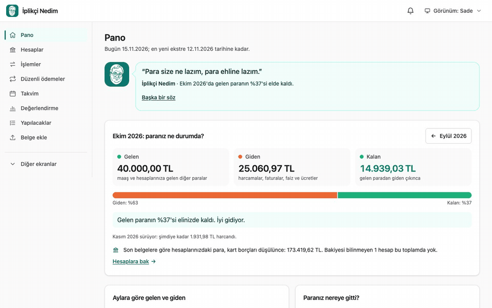
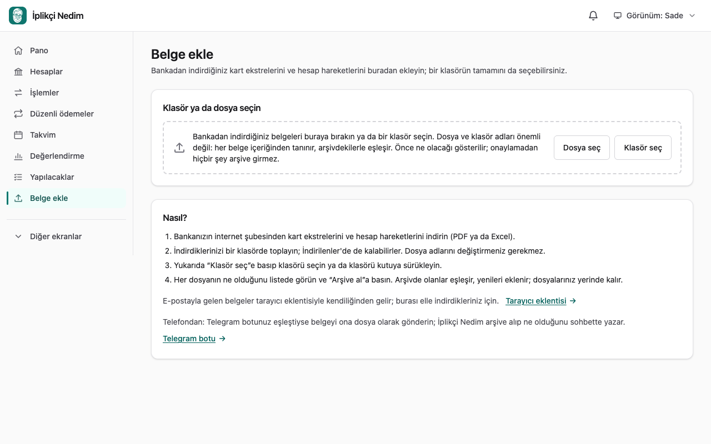
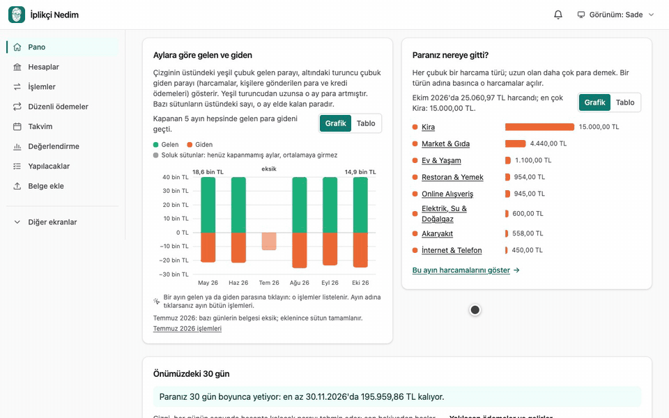
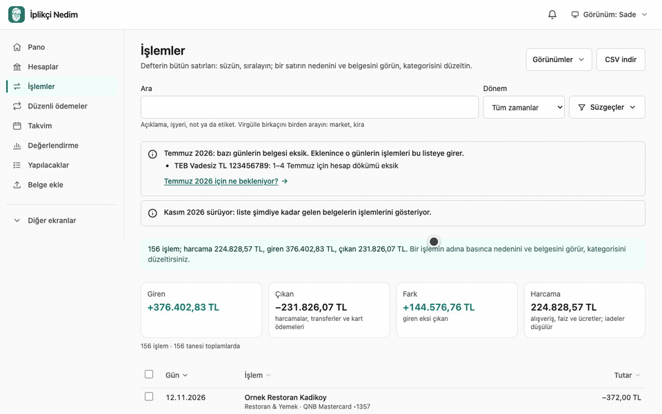
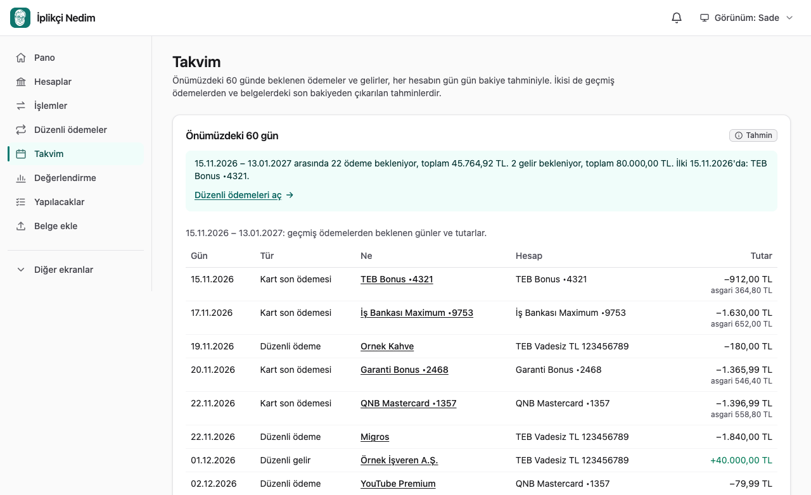
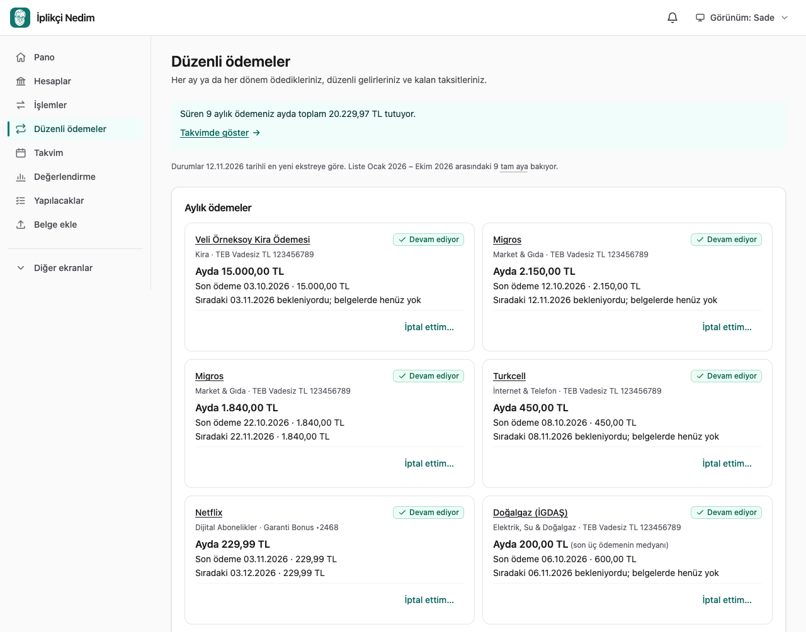
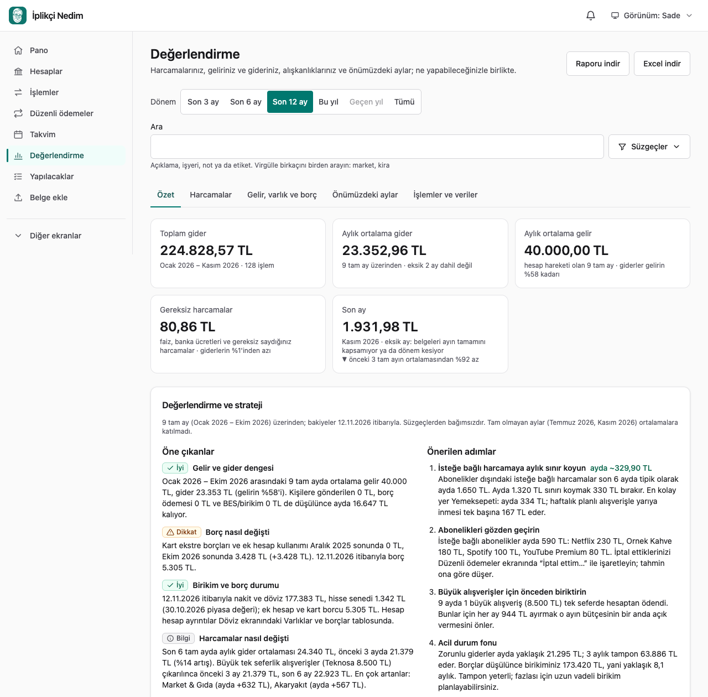
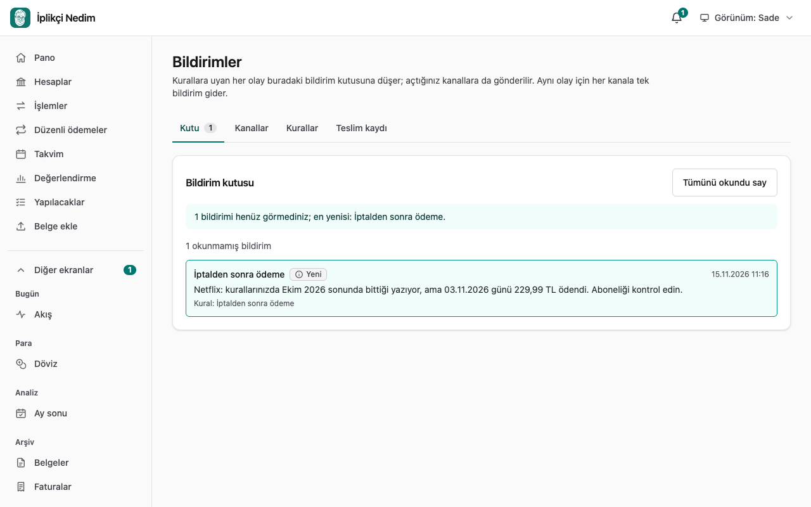
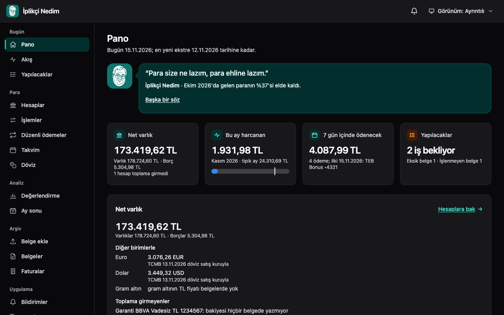
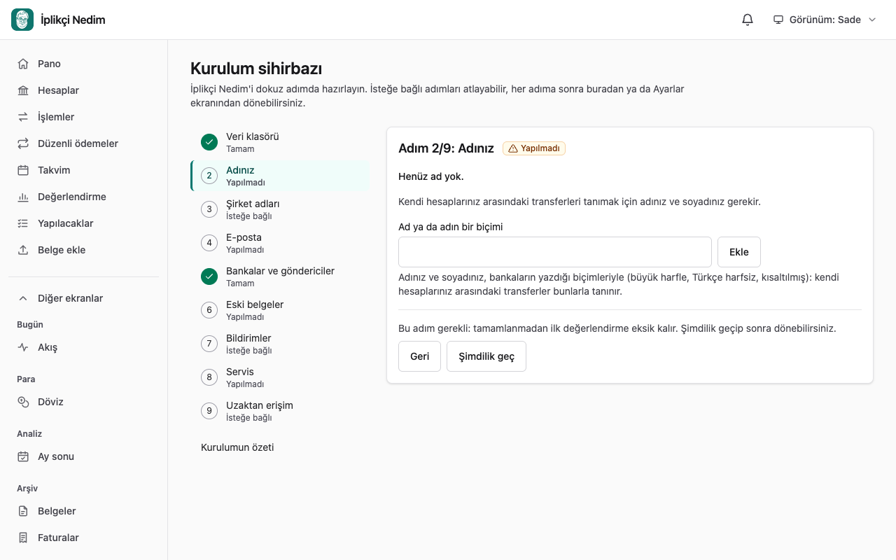

  

<h1 align="center">İplikçi Nedim</h1>

  Bankalarınızın gönderdiği belgelerden paranızın nereye gittiğini çıkaran, 
  ne yapmanız gerektiğini söyleyen ve kendi bilgisayarınızda çalışan kişisel finans asistanı.

  

Ücretsiz · Açık kaynak · Hesap açmak yok · Verileriniz bilgisayarınızda kalır

  

## Ne yapar?

Bankalar her ay ekstre, dekont ve bildirim gönderir; çoğu okunmadan e-posta kutusunda kalır. İplikçi Nedim onları
sizin yerinize toplar, okur ve tek bir yerde, resimlerle anlatır:

- **Para nereye gitti?** Biten ayda ne geldi, ne gitti, ne kaldı; en çok neye harcadınız.
- **Önümüzde ne var?** Kart son ödemeleri, düzenli ödemeler, maaş günü ve önümüzdeki günlerde hesabınızda ne
  kalacağı.
- **Ne yapmalı?** Eksiye düşecek bir hesap, zamlanan bir ödeme ya da gelmeyen bir maaş varsa söyler.

Bankanıza bağlanmaz, banka şifrenizi hiç istemez: size zaten gelen belgeleri okur.

## Belgeleri kendisi toplar

  

- Gmail'deki banka e-postaları tarayıcı eklentisiyle kendiliğinden gelir. Eklenti Gmail'de hiçbir şeyi değiştirmez:
  iletiler okunmamış kalır, taşınmaz, silinmez.
- Bankanın uygulamasından indirdiğiniz ekstreyi ya da dekontu "Belge ekle" ekranına sürükleyin ya da Telegram'daki
  kendi botunuza gönderin. Dosyanın adı önemli değildir; İplikçi Nedim her belgeyi içeriğinden tanır.
- Her belgenin aslı saklanır. Ekrandaki her rakamdan dayandığı belgeye gidebilirsiniz.

## Bir tıkla ayrıntıya

  

Bir grafikte bir aya ya da bir dilime tıklayın: o rakamı oluşturan işlemler açılır, toplamları da aynıdır.

  

Aradığınızı virgülle ayırarak yazın: iki şeyi birden bulur ve her birinin kaç işlem tuttuğunu söyler.

## Yaklaşan ödemeleri önceden görürsünüz

  

Takvim önümüzdeki 60 günü gösterir: kart son ödemeleri asgari tutarlarıyla, düzenli ödemeler ve gelirler. Hesabınız
eksiye düşecekse o günü önceden söyler.

  

Düzenli ödemeler abonelikleri ve faturaları kendisi bulur; tutarı değişeni ve artık ödenmeyeni ayırır.

## Paranızın değerlendirmesi

  

Değerlendirme seçtiğiniz dönemi anlatır: harcamanın nereye gittiğini ve nasıl değiştiğini, gerekli ve gereksiz
harcamaları, gelirle gideri, net varlığınızı ve borçlarınızın seyrini. Ortalamaları yalnızca bitmiş aylardan alır;
her bulgu hangi aylara dayandığını yazar.

## Haber verir

  

Son ödeme yaklaşınca, bir düzenli ödemenin tutarı değişince, beklenen bir ödeme gelmeyince, iptal ettiğiniz bir
abonelikten yine para çekilince ya da büyük bir harcamada haber verir: uygulamanın içinde, bilgisayarınızın
bildirimlerinde ya da isterseniz Telegram'da. Gece rahatsız etmez; o saatlerde olanlar sabah tek bir özetle gelir.

## İplikçi Nedim konuşur

  

Pano'nun en üstünde İplikçi Nedim paranızın durumuna göre sözlerinden biriyle seslenir. Yüzü işler iyi giderken
yeşil, dikkat isteyen bir durumda turuncu, kötü bir durumda kırmızı, söyleyecek bir şey yokken gridir. Neden o sözü
söylediği altında tek cümleyle yazar. Adını parayı sıkı tutan bir karakterden alır; İngilizce adı Money-Grubber.

  

İsterseniz sade görünüm yerine ayrıntılı görünümü, açık tema yerine koyu temayı seçin.

## Claude'a sorun (isteğe bağlı)

Claude'u bağlarsanız "Bu ay neden fazla harcadım?" ya da "Hangi aboneliklerim var?" gibi sorulara İplikçi Nedim'deki
verilerinize ve belgelerinize bakarak cevap verir. Bir kuralı ya da bir işlemi değiştirmeden önce ne değişeceğini
gösterir ve onayınızı bekler. Claude bağlantısı ekranı nasıl bağlanacağını adım adım gösterir.

## Verileriniz sizde kalır

- İplikçi Nedim bilgisayarınızda çalışır. Bulut yok, hesap açmak yok, abonelik yok.
- Belgeleriniz ve verileriniz bilgisayarınızdan çıkmaz; her gece yedeği alınır. Hiçbir belge kalıcı olarak silinmez.
- Banka şifrenizi ya da Gmail şifrenizi hiç istemez.
- İnternete yalnızca banka e-postalarını okumak (yalnızca okur), döviz kurlarını TCMB'den almak, isterseniz
  Telegram'a bildirim göndermek ve yeni sürüm olup olmadığına bakmak için çıkar. Kullanımınızla ilgili hiçbir bilgi
  toplamaz.
- Yalnızca kişisel paranızla ilgilenir: şirket kartları, ticari hesaplar ve bordro okunmaz.

## Hangi bankalar?

Garanti BBVA, İş Bankası, QNB, TEB ve VakıfBank: kart ekstreleri, hesap dökümleri, dekontlar ve bankaların bildirim
e-postaları. e-Fatura ve e-Arşiv faturaları da okunur ve onları ödeyen banka işlemiyle eşleşir. Bankanız listede
yoksa [bize yazın](https://github.com/msaidbilgehan/iplikci-nedim/issues).

## Kurulum

Şimdilik yalnızca **macOS** için (Apple Silicon: M1 ve sonrası). Windows ve Linux sürümleri yolda.

1. **İndirin:** [İplikçi Nedim'i indirin](https://github.com/msaidbilgehan/iplikci-nedim/releases/latest/download/iplikci-nedim-macos-aarch64.dmg),
   dosyayı açın ve İplikçi Nedim'i yanındaki "Applications" klasörüne sürükleyin.
2. **Açın:** Uygulamalar klasöründen açın. İlk açılışta macOS **“İplikçi Nedim” Açılmadı** uyarısını gösterir,
   çünkü uygulama Apple'ın ücretli onayından geçmedi. "Bitti"ye basın; sonra Sistem Ayarları → Gizlilik ve
   Güvenlik'te "Yine de Aç"a basıp parolanızı girin.
3. **Sihirbazı izleyin:** Tarayıcınızda kurulum sihirbazı açılır. Adınızı (kendi hesaplarınız arasındaki
   havaleleri tanısın diye), e-postanın nasıl geleceğini, bankalarınızı ve bildirimleri sorar; Gmail için tarayıcı
   eklentisinin nasıl ekleneceğini de adım adım gösterir.

  

Terminal açmanız ya da başka bir program kurmanız gerekmez. İplikçi Nedim her gün yeni sürüm olup olmadığına bakar;
varsa önce verilerinizin yedeğini alır, sonra kendini günceller.

**Kaldırmak için** Ayarlar'daki "Kaldır"a basın, sonra uygulamayı çöp kutusuna sürükleyin. Verileriniz yalnızca siz
isterseniz çöp kutusuna taşınır.

## Sık sorulanlar

<b>Ücretli mi?</b>

Hayır. İplikçi Nedim ücretsizdir ve kodu herkese açıktır.

<b>Bankama bağlanıyor mu, şifremi istiyor mu?</b>

Hayır. Bankanızın sitesine ya da uygulamasına bağlanmaz. Bankanın size zaten gönderdiği e-postaları ve sizin
eklediğiniz belgeleri okur.

<b>Neden bazı rakamlar "şimdilik" diyor?</b>

Kart ekstresi ay bitince değil, kesim gününde gelir. Bir ayın bütün belgeleri gelene dek rakamları kesinleşmez;
İplikçi Nedim hangi belgeyi ve ne zaman beklediğini yazar.

<b>Bilgisayarım kapalıyken ne olur?</b>

Bir şey kaçmaz: bilgisayar açılınca gelen e-postaları ve bekleyen işleri kendisi tamamlar.

<b>macOS neden "Açılmadı" diyor?</b>

Apple'ın ücretli geliştirici onayı alınmadı. Kurulumdaki ikinci adım uygulamaya bir kez izin verir; sonra uyarı
gelmez.

<b>Windows ya da Linux'ta çalışır mı?</b>

Yakında. Paketleri hazırlanıyor, o sistemlerde denendikten sonra burada duyurulacak.

## Geliştiriciler için

İplikçi Nedim Python ve React ile yazıldı. Kodun yapısı, komutlar ve kararlar
[geliştirici rehberinde](docs/gelistirme.md), sürüm notları [CHANGELOG](CHANGELOG.md)'da.

## Lisans

[BSD 3-Clause](LICENSE.txt).
