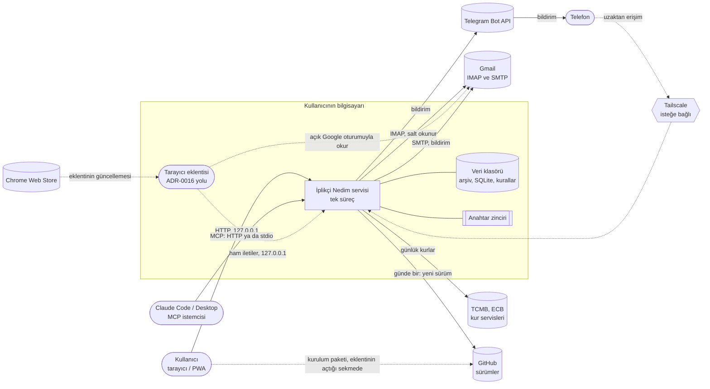
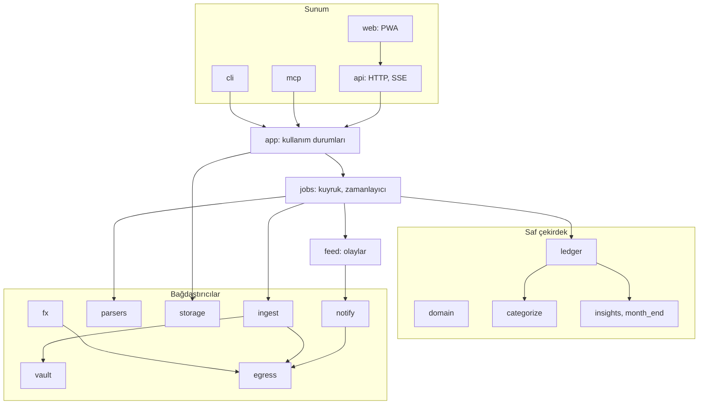
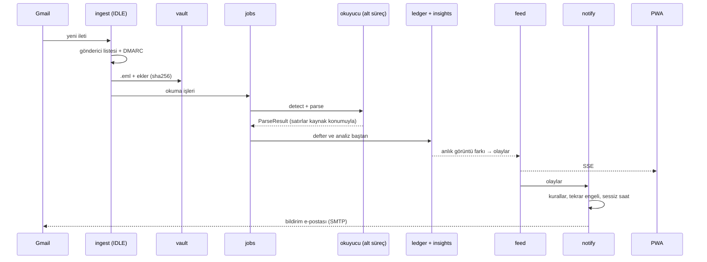
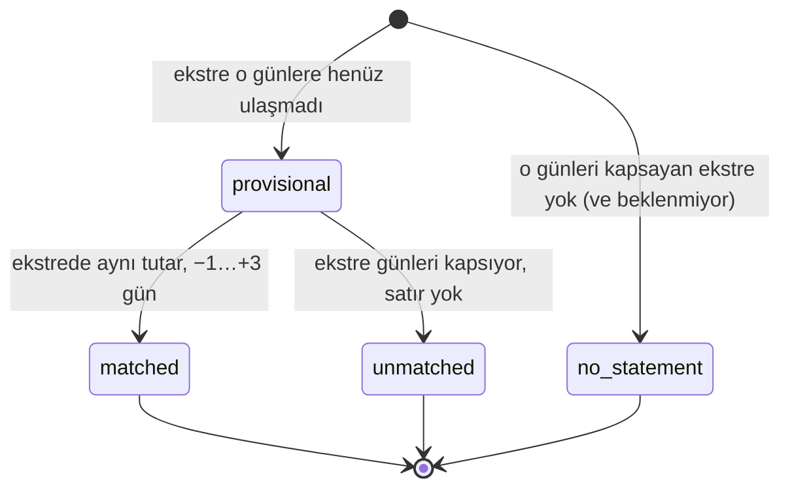

# V1 mimarisi

Proje: İplikçi Nedim · Durum: son hâli, uygulamaya hazır · Tarih: 2026-10-31 · İlgili belgeler:
[gereksinimler](requirements.md), [özellikler](features.md), [yol haritası](roadmap.md), [geçiş](migration.md),
[ADR'ler](../adr/README.md), [alan kuralları](../domain/)

Bu belge V1'in **hedef** mimarisidir. MVP'nin bugünkü yapısı [gereksinimler](requirements.md)'deki "Bugün"
bölümlerindedir; ikisi arasındaki yol [yol haritası](roadmap.md)'ndadır.

## 1. Özet

İplikçi Nedim, kullanıcının bilgisayarında sürekli çalışan **tek bir Python servisidir** (modüler monolit, ADR-0001).
Servis şu işleri yapar:

- Bankaların ve diğer güvenilen göndericilerin e-postalarını IMAP IDLE ile anında alır (ADR-0015). Uygulama şifresi
  olmayan hesaplar (Gelişmiş Koruma'daki Gmail) için yol, Gmail'in web arayüzünü kullanıcının açık oturumuyla okuyan
  İplikçi Nedim tarayıcı eklentisidir (ADR-0016). Elle eklenen belgeleri de kabul eder.
- Her belgeyi içerik adresli bir **arşivde** bir kez saklar (ADR-0003).
- Belgeleri eklenti **okuyucularla** alt süreçte okur (ADR-0005).
- Okunan satırları ve kullanıcı kararlarını **SQLite**'ta tutar (ADR-0004).
- Defteri ve yorumu her alım partisinden sonra baştan hesaplar.
- Değişiklikleri **olaylara** çevirir (ADR-0014). Olaylar anlık akışa (SSE), bildirim kurallarına (e-posta, Telegram,
  masaüstü; ADR-0010) ve MCP'ye (ADR-0011) gider.

Arayüz, servisin sunduğu bir React PWA'dır (ADR-0008). Bütün kişisel veri depo dışındaki veri klasöründe durur
(ADR-0002). Ağa yalnızca izin verilen işler için çıkılır (ADR-0009).

**Adlar:** ürün adı İplikçi Nedim, depo ve dağıtım adı `iplikci-nedim`. Teknik adların hepsi kısa adı kullanır:

- Python paketi ve komut `iplikci`; veri klasörü `iplikci/`; `IPLIKCI_*` ortam değişkenleri;
- `iplikci` anahtar zinciri hizmeti; `com.iplikci.*` servis etiketleri; `X-Iplikci` başlığı;
- `iplikci://` MCP kaynakları ve `iplikci.parsers` giriş noktası grubu.

Kısa adın gerekçeleri:

- Yazması kolaydır.
- PEP 8'in kısa paket adı önerisine uyar.
- Ürün adı yeniden değişse de veri yolları ve sırlar yerinde kalır.

## 2. Hedefler ve kısıtlar

İşlevsel gereksinimler [requirements.md](requirements.md) (G1–G13), ayrıntılı davranış [features.md](features.md)'dedir.

**İşlevsel olmayan hedefler**

| Ölçü | Hedef |
|---|---|
| Yeni banka e-postasının akışa düşmesi | ≤ 10 sn (IDLE bağlıyken); eklenti köprüsünde tarayıcı açıkken ≤ 5 dk (ADR-0016) |
| Elle eklenen tek belgenin akışa düşmesi | ≤ 5 sn |
| API yanıtı | p95 < 200 ms (10 bin işlemde) |
| Defteri ve analizi baştan hesaplamak | < 2 sn (10 bin işlemde) |
| Bütün arşivi yeniden okumak | < 60 sn (bugünkü ~150 belge MVP'de ~10 sn) |
| Servisin açılışı | < 5 sn |
| Bellek | < 500 MB (okuma alt süreçleri hariç) |
| Çalışma | bilgisayar uyanıkken; uykudan sonra kaçırılan işler tamamlanır |
| Kayıp toleransı (RPO) | belgeler: 0 (arşiv değişmez, Time Machine); kullanıcı kararları: ≤ 1 gün (günlük yedek) |
| Kurtarma (RTO) | veritabanını arşivden yeniden kurmak < 10 dk |

**Kesin kısıtlar**

- Platform: Windows, macOS ve Linux (K15). Son kullanıcı terminal kullanmaz (K14, ADR-0017). Metin tanıma (OCR)
  şimdilik yalnızca macOS'ta.
- Teknoloji ve dil: Python 3.13 + uv. Arayüz metinleri Türkçe; kod, yorum ve tanımlayıcılar İngilizce.
- Yalnızca kişisel para hareketleri işlenir; şirket belgeleri okunmaz, saklanmaz, raporlanmaz.
- Belgeler:
  - Kalıcı silme yoktur; sha256'sı farklı bir dosyanın üzerine yazılmaz.
  - Banka belgeleri ve e-postalar güvenilmez girdidir.
- Gizlilik:
  - Ağa yalnızca izin listesindeki işler için çıkılır (ADR-0009).
  - Depoda kişisel veri yoktur.
- Kapsam: hobi projesi, kurumsal ürün değil. Yine de her kullanıcıya hizmet eder ve kullanıcının kendine özgü
  bilgileri koda yazılmaz.

**Tercihler:** az bağımlılık, standart kütüphane önce, açıklanabilir kurallar, finanstan anlamayan kullanıcı için sade
dil.

## 3. Kapsam dışı

- Şirket belgeleri ve ticari hesaplar.
- Birden çok kullanıcı, hane paylaşımı (ileride).
- İnternet şubesine otomatik giriş ve ekran kazıma; açık bankacılık API'leri.
- Bulut eşitleme, sunucuya kurulum.
- Yapay zekâ asistanı ve strateji uzmanları (V2), yatırım tavsiyesi, vergi beyannamesi.

## 4. Seçenekler ve öneri

| Seçenek | Özü | Neden seçilmedi / seçildi |
|---|---|---|
| A — MVP'yi büyütmek | CLI, zamanlanmış görevler, tek dosyalık rapor | Anlık akış ve anında bildirim yapılamaz; panel eski kodla kalır; JSON önbellek notları taşıyamaz. |
| **B — Modüler monolit servis** | Tek süreç, SQLite, içerik adresli arşiv, PWA | **Seçildi:** gereksinimlerin hepsini en az parçayla karşılar (ADR-0001). |
| C — Çok servisli yapı | API, işçi, Redis, Postgres, Docker | Tek kullanıcı için işletim yükü; Docker içinden anahtar zinciri ve OCR'ye erişim zor. |

Önerinin değişeceği durum: birden çok kişinin birden çok cihazdan aynı anda yazması (sunucu, Postgres, kullanıcı
hesapları).

## 5. Sistem bağlamı



Gösterim: dikdörtgen bizim sürecimiz, silindir veri ya da dış servis, kesikli çizgi isteğe bağlı bağlantı. Oklar
bağlantıyı kimin başlattığını gösterir; Telegram bağlantısını da servis başlatır (uzun yoklama).

## 6. Bileşenler



Python paketi `iplikci`, `src/iplikci/` altındadır:

| Modül | Sorumluluk |
|---|---|
| `domain` | Modeller, `Money` ve `Quantity`, kodlar ve Türkçe etiketleri, saf yardımcılar. Hiçbir iç modüle bağlı değildir. |
| `settings` | Veri klasörünü bulmak, `settings.toml`, anahtar zinciri, ortam değişkenleri. |
| `storage` | SQLite bağlantısı, göçler, depo modülleri, FTS. |
| `vault` | Nesne deposu, `staging`, türetilmiş veriler, çöp kutusuna taşıma, bütünlük denetimi. |
| `ingest` | E-posta bağlayıcıları (IMAP IDLE ve tarayıcı eklentisi köprüsünün alım ucu, ADR-0016) ve güven kuralı; yükleme; gelen klasörü; Telegram botunun dinleyicisi (ADR-0021); içe aktarma; zip ve mbox açma. |
| `parsers` | Kayıt defteri, sözleşme, okuyucular; PDF, tablo, HTML ve e-posta yardımcıları; OCR. |
| `ledger` | Birleştirme, maskeli hesap çözümü, kanıt uzlaştırma, transferler, kur çevirisi, fatura eşleştirme, kapsama. |
| `categorize` | Kural katmanları, eşleştirme, gereklilik, kural dosyasını doğrulayarak düzenleme. |
| `insights` | Bulgular, düzenli ve dönemsel ödemeler, alışkanlıklar, tahmin, varlıklar, nakit akışı öngörüsü. |
| `month_end` | Ay kapanışı. |
| `fx` | Kur sağlayıcıları, kur seçimi, enflasyon serileri. |
| `feed` | Olay kaydı, anlık görüntü farkı, SSE yayını. |
| `notify` | Bildirim kural motoru, kanallar, teslim kaydı. |
| `jobs` | İş kuyruğu, zamanlayıcı, işçiler. |
| `egress` | İzin verilen dış bağlantılar (ADR-0009). |
| `update` | Programın kendi güncellemesi (ADR-0022): sürüm bildirgesi ve Ed25519 imzası, güvenilen anahtarlar, sürümlerin yeri, kopyayı hangi kurulumun koyduğu ve yeni sürümün yerine konması (macOS'ta `Contents`, Linux'ta yeni kopya, Windows'ta sessiz kurulum programı). Depoya ve ağa dokunmaz; indirmeyi ve durumu `app/update` yapar. |
| `app` | Kullanım durumları (e-postayı şimdi al, planla, uygula, not ekle…); `api`, `mcp` ve `cli`'nin ortak giriş noktası. |
| `api` | FastAPI uygulaması, kimlik doğrulama, SSE, PWA dosyaları. |
| `mcp` | MCP sunucusu ve stdio köprüsü. |
| `cli` | Kullanıcı ve geliştirici komutları. |
| `export` | CSV, XLSX, tek dosyalık HTML rapor, ay sonu sayfaları. |
| `service` | Süreç başlatma, servis yöneticisi entegrasyonu, tek kopya kilidi, yaşam döngüsü. |
| `web/` (depo kökünde) | PWA; ayrı bir TypeScript projesi. |
| `extension/` (depo kökünde) | Tarayıcı eklentisi (Chromium, Manifest V3); ayrı bir TypeScript projesi (ADR-0016). |

**Bağımlılık kuralları**

- `domain` hiçbir iç modülü içe aktarmaz.
- `ledger`, `categorize`, `insights` ve `month_end` yalnızca `domain`'i ve birbirlerini kullanır. Veritabanına, dosyaya
  ya da ağa dokunmazlar.
- Sunum (`api`, `mcp`, `cli`) yalnızca `app`'i kullanır.
- Ağa yalnızca `egress` çıkar.
- Bu kurallar import-linter benzeri bir testle denetlenir.

## 7. Akışlar

**Bankadan e-posta geldiğinde**



**Elle ekleme:** yükleme, `staging`'e yazılır ve okunur; kullanıcıya plan gösterilir (hangi belge, hangi hesap, ne
olacak); kullanıcı onaylayınca arşive alınır. Gelen klasörüne bırakılan dosyalar klasör 20 sn sessiz kalınca aynı
yoldan, onaysız alınır. MCP'den içe aktarma planı Claude'un kullanıcıya göstermesi için döner.

**Telegram'dan belge** (ADR-0021): servisin dinleyicisi (`ingest.telegram`) botun iletilerini uzun yoklamayla okur,
her okuma en çok 25 sn bekler. `app.telegram` her iletiyi kaldığı yerle aynı işlemde bir kez işler: eşleştirme kodu
sohbeti eşleştirir; eşleşmiş özel sohbetin belgesi `telegram.document` işi olur, başka sohbetlerinki yok sayılır. İşçi
dosyayı Telegram'ın dosya sunucusundan indirir (`egress.https_get`, 20 MB'ye kadar), yükleme alanına koyar ve
arayüzdeki yükleme gibi planlayıp onaysız uygular (kaynak `telegram`). Sonra belgeyi getiren iletiye ne olduğunu
yazar.

**Okuyucu güncellemesi:** açılışta kayıt defterindeki sürümler okunan belgelerinkilerle karşılaştırılır; değişen
okuyucunun belgeleri ve işlenmeyen belgeler yeniden okunur; defter baştan hesaplanır; değişen satırlar olay olur.

**Kullanıcı düzeltmesi:** kategori ya da not değişikliği işlemin parmak izine yazılır; kural olarak kaydedilirse
`rules/personal.yaml` doğrulanarak güncellenir, önceki sürüm `rules/history/`'ye alınır; etkilenen işlemler gösterilir.
Defterin bir kuraldan ya da bulamadığından çözdüğü bir transfere verilen kategori, bir kuralın vereceği türü de getirir
(`Categorizer.kind_for`, `annotate.kind_in`); kart alışverişi ve kendi transferiniz diye bilinen satır türünü korur.

## 8. Veri modeli

| Varlık (tablo) | Sınıf | İçerik |
|---|---|---|
| `documents` | üst veri (asıl kaynak arşivde) | sha256, tür, banka, durum, neden, okuyucu ve sürümü, doğrulama, dönem, görünen ad, üst belge (e-posta) |
| `document_sources` | asıl | kaynak türü (`email`, `upload`, `inbox`, `import`), Message-ID, gönderen, tarih, konu, özgün ad, zaman |
| `accounts` | türev + kullanıcı etiketi | banka, tür, para birimi, numara (maskeli gösterilir), takma ad |
| `statements` | türev | tür, dönem, kesim, önceki ve son bakiye, satır satır kontroller, doğrulama, son ödeme tarihi, asgari ödeme, limit, ekstrenin yazdığı sonraki kesim |
| `transactions` | türev | tarih, tutar (en küçük birim), para birimi, tür, açıklama, karşı taraf, taksit, orijinal tutar, kesinlik, kaynak konumu, parmak izi |
| `evidence` | türev | dekont ve banka bildirimi satırları, uzlaştırma durumu, eşleştiği satır |
| `invoices` | türev | banka dışı e-postalar: satıcı, tutar, tarih, son ödeme tarihi, kalemler, eşleştirme durumu |
| `links` | türev | transfer eşleri, kanıt↔satır, fatura↔satır |
| `annotations` | **birincil** | parmak izine bağlı not, etiket, kategori ve gereklilik düzeltmesi, bölme |
| `memories` | **birincil** | Claude'un kullanıcının parasına dair konuşmalar arası notları (finansal kontroller ve kararlar): ad, tür, tek satırlık açıklama, metin, ilk ve son yazıldığı zaman, son yazan (ADR-0023) |
| `analysis_snapshots` | türev | yorum, düzenli ödemeler, alışkanlıklar, tahmin, varlıklar, ay kapanışları (JSON) |
| `fx_rates` | dış kaynak | tarih, döviz çifti, alış ve satış, kaynak |
| `price_index` | dış kaynak (isteğe bağlı) | EVDS serisi, ay, değer (TÜFE) |
| `events` | **birincil** (günlük) | tür, zaman, yük, ilgili kimlikler |
| `jobs`, `deliveries` | işletim | iş kuyruğu; gönderilen bildirimler |
| `mail_accounts` | işletim | adres, klasör, UIDVALIDITY, son UID, başlangıç günü, son hata |
| `audit_log` | **birincil** (günlük) | kim (kullanıcı, MCP, sistem, taşıma), ne, ne zaman, hedef |

Kategori ve bildirim kuralları veritabanında değil, veri klasöründeki YAML dosyalarındadır (§20).

**Kimlikler**

- Belge kimliği: sha256.
- İşlem satırı kimliği: belge sha256 + okuyucu kimliği + satır sırası.
- İşlemin **parmak izi**: (hesap, tarih, tutar, para birimi, sadeleştirilmiş açıklama, aynı satırlar arasındaki sıra).
  Notlar ve düzeltmeler parmak izine bağlanır; böylece yeniden okumada kaybolmazlar. Yeniden okumadan sonra eşi
  bulunamayan not "yetim" olarak Yapılacaklar'a düşer.
- Aynı gün aynı tutarlı satırların hepsi gerçektir; sıra numarası bu yüzden parmak izinin parçasıdır.
- Parmak izi, satır okuyucunun okuduğu haliyle alınır: açıklama yeniden yazılmadan, döviz tutarı TL'ye çevrilmeden
  önce. Açıklamanın yalnızca harf ve rakamları sayılır; para birimi ISO koduyla yazılır.
- Aşama 1'de parmak izi defter kurulurken bellekte hesaplanır; `transactions` tablosunda tutulmaz. Sıra numarası
  bütün belgelerin satırlarına göre verildiği için tek bir belge okunurken bilinemez.
- Bir ekstrenin doğruladığı dekont satırı defterden çıkar; notu ekstre satırına geçer.

**Kesinlik**

Her işlem ve toplam bir kesinlik taşır:

| Kod | Anlamı | Toplamlara girer mi? |
|---|---|---|
| `confirmed` | Ekstre ya da döküm satırı. | Evet. |
| `provisional` | Ekstresi henüz gelmemiş günlerdeki dekont ya da banka bildirimi. | Evet; "geçici" etiketiyle. |
| `excluded` | Ekstre o günleri kapsıyor ama satırı göstermiyor. | Hayır; işaretlenir. |
| `info` | Eşleşmeyen banka dışı e-posta. | Hayır; bilgi olarak görünür. |

Kanıtların (dekont ve banka bildirimi) yaşam döngüsü:



Durumların kuralları [domain/ledger.md](../domain/ledger.md)'dedir.

## 9. Veri klasörü

```text
~/Library/Application Support/iplikci/     (IPLIKCI_HOME ile değiştirilebilir; Linux ve Windows: ADR-0002)
├── settings.toml          # ayarlar; sır içermez
├── iplikci.db             # SQLite (WAL)
├── vault/
│   ├── objects/ab/cd/<sha256>   # asıllar, değişmez, salt okunur
│   ├── staging/                 # okunmakta olan, kalıcı değil
│   └── derived/<sha256>/        # sayfa resimleri, metin, kelime kutuları (yeniden üretilebilir)
├── rules/
│   ├── personal.yaml      # kişisel kategori kuralları ve kararlar (kira, aile, _biten, …)
│   ├── alerts.yaml        # bildirim kuralları
│   └── history/           # her değişiklikten önceki sürüm
├── inbox/                 # izlenen gelen klasörü
├── exports/               # CSV, XLSX, tek dosyalık rapor, ay sonu sayfaları
├── backups/               # günlük tutarlı yedekler (yer ayarlanabilir)
├── logs/                  # JSON günlükler, dönerek
├── baseline.json          # doğrulama tabanı (iplikci dogrula --taban)
├── extension/             # tarayıcı eklentisinin dosyaları, tarayıcı buradan yükler (K20); istenince yapılır,
│                          #   program güncellenince servis açılırken yenilenir
├── archive/mvp/           # MVP'nin kodu, testleri, kuralları ve ayarları (2026-10-31); salt başvuru, V1 okumaz
└── run/                   # kilit, servis durumu; guncelleme.json: son sürüm denetimi, bulduğu sürüm, süren ve son
                           #   kurulum (ADR-0022)
```

Klasörün izni 0700, dosyalarınki 0600'dür. Uygulamayla gelen genel kategori kuralları paketin içindedir
(`iplikci/rules/default.yaml`) ve kişisel kurallar onların üstüne biner.

## 10. Okuyucular

Sözleşme, seçim, sürüm ve yalıtım ADR-0005'tedir. Her okuyucu `src/iplikci/parsers/<banka>/<belge>.py` modülündedir:
kimlikteki nokta klasörü ayırır (`garanti.bonus_card` → `parsers/garanti/bonus_card.py`). Başlangıçtaki eklentiler
MVP'nin okuyucularından çıkar:

| Kimlik | Belge | MVP'deki yeri |
|---|---|---|
| `garanti.bonus_card` | Bonus kredi kartı ekstresi (PDF) | `parsers/garanti.py` |
| `garanti.paracard` | Paracard banka kartı cetveli (PDF) | `parsers/garanti.py` |
| `garanti.account_xls` | Hesap hareketleri (XLS) | `parsers/hesaplar.py` |
| `garanti.receipt` | Dekont (PDF) | `parsers/garanti_dekont.py` |
| `garanti.brokerage` | Yatırım hesabı ekstresi, işlem sonuç formu (PDF) | `parsers/garanti_yatirim.py` |
| `isbank.maximum_card` | Maximum kart hesap özeti (PDF) | `parsers/isbank.py` |
| `isbank.account_xls` | Hesap özeti (XLS) | `parsers/hesaplar.py` |
| `isbank.receipt` | FAST/EFT dekontu (PDF) | `parsers/isbank_dekont.py` |
| `isbank.passbook` | e-cüzdan (PDF) | `parsers/isbank_cuzdan.py` |
| `teb.bonus_card` | Bonus kart ekstresi (PDF; sayfa resmi olanlar OCR ile) | `parsers/teb.py` |
| `teb.card_payment_receipt` | Kart ödeme dekontu (PDF) | `parsers/teb.py` |
| `teb.account_html` | Hesap hareketleri (`.xls` adlı HTML) | `parsers/hesaplar.py` |
| `teb.passbook` | Dijital hesap cüzdanı (PDF) | — (V1, v0.9.14) |
| `qnb.card_pdf` | Kredi kartı ekstre hareketleri (PDF) | `parsers/qnb_pdf.py` |
| `qnb.account_pdf` | Ek hesap / hesap hareketleri (PDF) | `parsers/qnb_pdf.py` |
| `qnb.edekont` | e-dekont (HTML, PDF) | `parsers/qnb.py` |
| `vakifbank.account_xlsx` | Hesap hareketleri (XLSX) | `parsers/hesaplar.py` |
| `vakifbank.passbook` | e-cüzdan (PDF) | `parsers/vakifbank_cuzdan.py` |

V1'in eklediği okuyucular:

| Kimlik | Belge | Aşama |
|---|---|---|
| `garanti.notice.transfer` | Para transferi bildirimi (e-posta gövdesi) | 4 |
| `isbank.notice.collection` | Gecikmiş kart borcu tahsilatı bildirimi (e-posta gövdesi) | 4 |
| `qnb.notice.transfer` | FAST, havale/EFT ve para çıkışı bildirimi (e-posta gövdesi) | 4 |
| `vakifbank.notice.transfer` | FAST ve para çıkışı bildirimi (e-posta gövdesi) | 4 |
| `invoice.ubl_tr` | e-Fatura ve e-Arşiv faturası (UBL-TR XML) | 4 |
| `teb.transfer_receipt` | Banka içi havale dekontu (PDF) | v0.9.16 |
| `vakifbank.receipt` | Uygulamanın paylaştığı transfer dekontu (PDF) | v0.9.16 |

Bir e-posta bütün olarak saklanır; ekleri kendi biçimlerinin okuyucularına gider. Gövdeyi `Format.EMAIL` okuyucuları
okur: seçici onlara gönderenin alan adını, konuyu ve gövdenin görünen metnini gösterir (`parsers/mail.py`). Bir
bildirimin satırları dekontunkiler gibi kanıttır; belge türü `notice`'tir.

V1'de eklenen aileler: banka bildirimleri (`<banka>.notice.*`), kart ekstrelerinde son ödeme tarihi, asgari ödeme ve
limit alanları, banka dışı göndericiler (`invoice.ubl_tr`, `receipt.<kurum>`, `bill.<kurum>`). Liste
[features.md F01, F14](features.md)'tedir. Banka biçimlerinin bilinen tuzakları
[domain/bank-formats.md](../domain/bank-formats.md)'dedir.

Her satırın kaynağı (`SourceRef`) okuyucu çıktısında zorunludur:

- PDF'de sayfa ve satırın kutusu (x0, top, x1, bottom); metni satır satır okuyan okuyucularda sayfa ve satır numarası.
- Tabloda sayfa adı ve satır numarası; HTML tablosunda sayfa adı boştur.
- HTML belgede ve e-postada metindeki aralık (başlangıç, bitiş).

Konum veritabanında satırla birlikte JSON olarak durur (`transactions.ref`, `evidence.ref`).

Okuma kalıcı bir alt süreçte yapılır (`parsers/worker.py`); sonuç JSON olarak döner ve her değerin türü denetlenir. Bir
okuyucu belgesini tanıyıp okuyamazsa ya da okuduğu ekstre doğrulanmazsa okuma işi `parser.format_alarm` olayını yazar
(§13). Her okuyucunun sahte belgeleri `iplikci.fakes` paketindedir; `iplikci dev parser probe | debug | test`
okuyucuları geliştiricinin sürecinde dener.

## 11. Defter ve kesinlik

Defter, okunan satırlardan her seferinde baştan kurulur. Adımlar sırayla:

1. Bir ekstrenin birden çok dosyası, (hesap, kesim, para birimi, başlangıç) üzerinden birleştirilir; satırı çok olan
   kopya kalır. Bir ekstrenin içindeki satırlar asla tekilleştirilmez.
2. Maskeli hesap numaraları tek bir hesaba bağlanır.
3. Kanıtlar (dekont, banka bildirimi) ekstrelerle uzlaştırılır (§8, durum makinesi).
4. Transferler çözülür: kendi hesaplar, kurallar, karşı satırlar, kişiler.
5. Dövizli satırlar çevrilir: belgedeki kur, yoksa TCMB/ECB kuru (§15). Kurun kaynağı satırda saklanır.
6. Banka dışı faturalar banka satırlarıyla eşleştirilir (`matched`, `pending`, `unmatched`).
7. Hesap ve ay başına kapsama hesaplanır.
8. Kategoriler, işyerleri ve gereklilik atanır.

Kuralların tamamı [domain/ledger.md](../domain/ledger.md) ve
[domain/categorization.md](../domain/categorization.md)'dedir.

## 12. Yorum, ay sonu ve öngörüler

MVP'nin yorum ve ay sonu kuralları aynen korunur ([domain/interpretation.md](../domain/interpretation.md)). Kuralların
özü: yalnızca tam aylar, düzensiz harcamayı yıllığa çevirmemek, her bulgunun penceresi ve rakamı.

**V1'de eklenenler**

- Dönemsel seriler (~182 ve ~365 gün).
- Son ödeme tarihleri ve asgari tutarlar.
- Nakit akışı öngörüsü (hesap başına gün gün bakiye).
- Borç görünümü.
- Olağan dışı hareketler.
- Kur makası maliyeti, döviz gelirinin etkisi, çoklu para birimiyle varlıklar.

**V1+ olarak eklenecekler**

- Enflasyondan arındırma.
- Bütçe ve hedefler.
- Senaryolar.
- Kişiler arası borç-alacak.
- Nakit cüzdanı.

Çıktılar `analysis_snapshots`'ta sürümlenir; API ve MCP son anlık görüntüyü okur.

## 13. Olaylar ve anlık akış

Her analizden sonra yeni anlık görüntü öncekiyle karşılaştırılır; fark olaylara dönüşür. Olaylar `events` tablosuna
yazılır (ADR-0014), SSE ile arayüze iletilir ve bildirim kurallarına girer.

| Olay | Ne zaman |
|---|---|
| `document.received`, `document.processed`, `document.unprocessed`, `document.unreadable` | belge geldi / okundu / tanınmadı / okunamadı |
| `transaction.created`, `transaction.confirmed` | yeni satır; geçici satır ekstreyle kesinleşti |
| `evidence.unmatched` | dekont ya da bildirim, kapsayan ekstrede yok |
| `invoice.matched`, `invoice.pending`, `invoice.unmatched` | banka dışı e-postanın eşleştirme sonucu |
| `payment.due_soon` | son ödeme ya da beklenen ödeme yaklaşıyor |
| `expected_payment.missing` | beklenen düzenli ya da dönemsel ödeme görünmedi |
| `balance.forecast_negative` | öngörüde hesap eksiye düşüyor |
| `transaction.large` | büyük tek seferlik harcama |
| `subscription.price_changed`, `subscription.paid_after_cancel` | zam; iptalden sonra ödeme |
| `income.received`, `income.late` | maaş ya da düzenli gelir geldi / gecikti |
| `month.ended`, `month.closed`, `month.needs_check` | ay bitti / kapandı / kontrol gerekli |
| `deposit.maturity_soon` | vadeli hesabın vadesi yaklaşıyor |
| `fx.threshold_crossed`, `budget.threshold` | kur eşiği; bütçe %80 / %100 (V1+) |
| `parser.format_alarm`, `mail.auth_failed`, `mail.bridge_alarm`, `mail.bridge_silent`, `backup.failed` | sistem olayları: okuyucu biçim alarmı; e-posta girişi reddedildi; eklentinin bir katmanı Gmail'in sayfasını tanımadı; eklenti bir gündür görünmedi; yedek alınamadı |
| `bridge.paired`, `bridge.revoked` | tarayıcı eklentisi eşleşti / eşleşmesi iptal edildi (denetim kaydına da yazılır) |

Aşama 5'in olaylarını her analizden sonra `feed/news.py` bulur. `target` bildirimin tekrar engelinin anahtarıdır,
`detail` bildirim metninin değerleridir. Tutarlar iki ondalıklı TL metnidir ("1234.56"; çıkan para artı, defterin
saydığı gibi), tarihler ISO biçimindedir. `title` kullanıcının tanıdığı addır (işyeri, alıcı, ödeyen, satıcı ya da
hesap), `account` hesap kimliğidir (bilinmiyorsa "").

Her olay, adı olmadan neyle ilgili olduğunu da söyler (`about`, v0.9.18). Ödeme, gelir ve harcamada bu kategoridir
("İnternet & Telefon", "Maaş"). Kartın son ödemesinde, kredi taksitinde, bir hesabın öngörüsünde ve dekontta hesabın
bankasıdır ("TEB"). Kanalların özet düzeyi bunu yazar (ADR-0010). Kategorisi ya da bankası bilinmeyen olayda alan yoktur.

| Olay | `target` | `detail` |
|---|---|---|
| `payment.due_soon` | `tür\|hesap\|başlık\|gün` | `payment` (`PaymentKind`), `title`, `account`, `due`, `days`, `amount`; kart son ödemesinde `minimum` |
| `balance.forecast_negative` | `hesap\|gün` | `account`, `title` (hesabın adı), `day`, `days` (analiz gününden), `balance` (o günün tahmini bakiyesi) |
| `expected_payment.missing` | `seri\|beklenen gün` | `title`, `expected`, `amount`, `period` (`SeriesPeriod`: `month`, `half_year`, `year`) |
| `income.late` | `seri\|beklenen gün` | `title`, `expected`, `amount` |
| `subscription.price_changed` | `seri\|yeni fiyatın ilk günü` | `title`, `old`, `new`, `since` |
| `subscription.paid_after_cancel` | `seri\|iptalden sonraki son ödemenin günü` | `title`, `amount`, `date`, `cancelled` (`YYYY-AA`) |
| `income.received`, `transaction.large` | satırın parmak izi | `title`, `amount` (gelir de artı), `account`, `date` |
| `evidence.unmatched` | satırın parmak izi | `title`, `amount`, `account`, `date`; döviz hesabının satırı belgedeki en yakın kurla TL'dir, kur yoksa tutar hesabın para birimindedir ve `currency` onu söyler |

- Seri, ilk ödemesinin parmak iziyle anılır (`upcoming.series_id`; API de böyle anar): aylık, dönemsel ve gelir
  serilerinde aynıdır.
- Bir türden 50'den fazla olay aynı anda çıkarsa o türün tek olayı olur: `target` boştur, `detail` `{"count": n}`'dir.
- Her olay bir kez söylenir. Anlık görüntü söylediği ya da yalnızca not ettiği her durumu, en son bulunduğu günden bir
  yıl sonrasına kadar hatırlar. Bu türleri tutmayan eski bir anlık görüntüden sonra ilk analiz onları yalnızca not
  eder. İlk anlık görüntü de yalnızca not eder; önümüzdeki haftanın ödemeleri (`payment.due_soon`) bunun dışındadır
  (`snapshot.FIRST_TOLD`).
- Eşikler ve kurallar [domain/interpretation.md](../domain/interpretation.md)'nin "Akış olayları" bölümündedir.

Akış ekranı bu olayları ve "şu an" özetini (tahmini bakiyeler, ay içi tempo, beklenen olaylar) gösterir.

## 14. Bildirimler

Kanallar, ayrıntı düzeyleri ve teslim kuralları ADR-0010'dadır. Kurallar `rules/alerts.yaml` dosyasındadır. Dosya
kullanıcıya açık olduğu için anahtarları Türkçedir:

```yaml
- ad: Son ödemeye 3 gün            # arayüzde görünen ad
  olay: payment.due_soon            # olay kodu (§13)
  kosul: {gun: 3}
  kanallar: [masaustu, telegram]
  ayrinti: ozet                     # tam | ozet | asgari
- ad: Büyük harcama
  olay: transaction.large
  kanallar: [masaustu]
- ad: Kartın son ödemesine 1 hafta
  olay: payment.due_soon
  kosul: {gun: 7, metin: TEB}
  kanallar: [masaustu, telegram]
  not: "Ekstre tutarı kadar dövizi bozdurun."  # kullanıcının yazısı, her bildirimin sonuna eklenir
```

Hazır kurallar baştan açıktır; kurulum sihirbazı Telegram ya da e-posta bağlanınca hangilerinin oraya da gideceğini
sorar:

- son ödemeye 3 gün,
- hesap eksiye düşecek,
- büyük harcama,
- düzenli ödeme tutarı değişti (zam ya da düşüş; bildirimin başlığı hangisi olduğunu söyler; v0.9.8'e dek adı
  "düzenli ödeme zammı", 2026-11-03'e dek "abonelik zammı"),
- iptalden sonra ödeme,
- beklenen ödeme gelmedi,
- maaş gecikti,
- ay kapandı / kontrol gerekli,
- ekstrede görünmeyen dekont,
- e-posta girişi reddedildi,
- okuyucu biçim alarmı,
- yedek alınamadı.

Aşama 5'te (2026-11-02) bunlara ay bitti ile tarayıcı eklentisinin iki uyarısı (bir gündür görünmüyor, Gmail sayfasını
tanımadı) eklendi. Kurallar `notify` paketinde, teslimler `app.notify`'da ve `notifications` tablosundadır:
- Bir kural `kosul`'da `gun`, `tutar` ve `metin`'i yalnızca olayı onları taşıyorsa kullanabilir.
- `sessiz_saat: false` olan kural sessiz saatte de gönderir.
- `not`, kullanıcının o kural için yazdığı tek satırlık (en çok 200 harf) yazıdır; kuralın her kanaldaki bildiriminin
  metninin sonuna yeni satırla eklenir: bildirim gelince ne yapılacağını hatırlatır (v1.0.9; kullanıcının dövizini
  kart ekstresinin son ödemesinden önce bozdurma hatırlatması).
- Uygulama içi kutu kuralın kanal listesinden bağımsız olarak her bildirimi alır.
Ayrıntılar [ADR-0010](../adr/0010-notification-channels.md)'un uygulama notundadır.

## 15. Döviz

| Kaynak | Ne için | Not |
|---|---|---|
| Belgedeki kur | o işlemin kendisi | bankanın uyguladığı gerçek kur; her zaman önce gelir |
| TCMB günlük kurları | belgede kur yoksa; varlık değerleme; makas karşılaştırması | resmî, ücretsiz, anahtarsız; iş günleri öğleden sonra yayımlanır |
| ECB ya da Frankfurter | TCMB'ye ulaşılamazsa | EUR bazlı, TRY dahil |
| TCMB EVDS (isteğe bağlı) | TÜFE (enflasyondan arındırma), altın | ücretsiz kayıt ve API anahtarı gerekir |

- Kurlar `fx_rates`'te tarihçeli saklanır. Hafta sonu ve tatil için önceki iş gününün kuru kullanılır.
- Kurulumda verinin kapsadığı tarihler için geçmiş kurlar bir kez çekilir; sonra her iş günü 16:30'dan sonra çekilir.
- Değerleme yönleri:
  - Varlıklar döviz alış kuruyla değerlenir, borçlar satış kuruyla.
  - Kur makası, işlemin yönüne uygun TCMB kuruyla karşılaştırılır. Örneğin kullanıcı EUR bozduruyorsa banka kuru,
    TCMB döviz alış kuruyla karşılaştırılır.
- Ağ yoksa belgedeki kurlar kullanılır; ekranda kurun tarihi yazar.
- Altın fiyatı için ücretsiz ve güvenilir bir kaynak doğrulanana dek altın, gram ve maliyetiyle gösterilir.

**Aşama 8'de uygulanan (2026-11-03)**

- Sağlayıcılar `fx` paketindedir (`tcmb`, `ecb`, `frankfurter`, `evds`); hepsi `egress.https_get` ile, yalnızca GET.
  Ayarlardaki `[fx] providers` sırası: TCMB, sonra adı geçen ilk referans sağlayıcı (varsayılan Frankfurter; ECB'nin
  sertifikası macOS'taki Python'da doğrulanmadı, ADR-0009'un notu). `document` tek başına ağa hiç çıkmamak demektir.
- Kurlar `fx_rates`'te (gün, birim, kaynak, alış, satış; tam ondalık metin), sorulan günler `fx_days`'te. Geçmiş verinin
  kapsadığı ilk günden düne kadar, en yeniden eskiye çekilir: çalıştırma başına en çok 400 istek ve iki dakika, istekler
  arasında yarım saniye; bitmezse sonraki çalıştırma kuyrukta bekleyen işlerden sonra kaldığı yerden sürer. TCMB'nin
  sunucusu istek başına üç saniye kadar sürüyor (TLS el sıkışması): süre sınırı olmasa uzun bir geçmiş servisin tek
  kuyruğunu dakikalarca tutardı. Analiz, geçmiş bitince bir kez yenilenir. Kur yayımlanmayan gün (404) bir kez sorulur.
  Art arda 10 iş günü bülten çıkmazsa bunlar tatil sayılmaz, hata yazılır (adresler değişmiş olabilir).
- Kur defteri (`fx.book.RateBook`): bir günün kuru o günün bülteni ya da en fazla 7 gün önceki son bültendir; aynı gün
  TCMB ECB'den, ECB Frankfurter'den önce gelir. Yuvarlama tek yerde: `to_tl`, `from_tl`.
- Kur makası (`exchange.spread`) ve döviz geliri (`exchange.foreign_income`) defterin üzerinde saftır; ağ ve depo
  yoktur. Makas yalnızca TCMB'yle karşılaştırılır: ECB'nin tek referans kurunun alış ve satış tarafı yoktur.
- Kurların durumu `GET /api/system`'in `rates` bölümündedir; `POST /api/fx/fetch` hemen çekim ister. İş `fx.rates`
  her gün 16:30'da kuyruğa girer; yeni kur gelince analiz yenilenir (`Workspace.signature` kurların sayısını ve son
  çekim anını içerir).
- Yeniden kurulum (`dogrula --yeniden-kur`) ve yedekler kurları dökümde taşır: analiz aynı kurlarla yapılır.
- TÜFE (V1+): kullanıcının EVDS anahtarı Ayarlar'da bir kez denenir ve anahtar zincirine yazılır, ayarlar
  `[fx] evds = true` der; anahtar girilmemiş bir veri klasörü anahtar zincirini bunun için okumaz.
  - Seri TÜİK'in 2025=100 genel endeksidir (`TP.TUKFIY2025.GENEL`). 0.9.0'ın istediği 2003=100 serisi (`TP.FG.J0`)
    EVDS'de arşive alındı ve Ocak 2026'da bitti (EVDS'nin seri listesi, 2026-11-03).
  - TÜFE her gün 10:30'da `price_index`'e çekilir (iş `prices.fetch`).
  - Analizin parçası değildir: Değerlendirme onu analizin yanında okur (`inflation.real_trend`), yalnızca ayarlar
    `evds = true` derken (`prices.index`). Anahtar kaldırılınca saklanan aylar silinmez ama okunmaz. Yeniden kurulum
    TÜFE'yi taşımaz; anahtar onu yeniden getirir.
  - En yeni ay, ayın endeksinin sonraki ayın 3'ünde çıktığı takvime göre gelmiş olması gerekenden eskiyse durum
    `behind` der (`prices.behind`): seri durmuş olabilir, Ayarlar bunu söyler.

## 16. API

| Yol | Amaç |
|---|---|
| `GET /api/events/stream`, `GET /api/events` | SSE olay akışı (`Last-Event-ID` ile kaldığı yerden; baştan açılan akış son dakikanın olaylarını yeniden söyler ve başladığı olayı adlı `start` olayıyla bildirir); bir bildirim oluşunca ya da gidince kimliksiz `notifications` olayı; olay kaydı, sayfalı |
| `GET /healthz` | servis ayakta mı; kimlik istemez |
| `GET /giris`, `POST /api/login-links`, `POST /api/logout` | tek kullanımlık giriş bağlantısı, oturum çerezine döner; çıkış (ADR-0007) |
| `GET /api/labels` | kodların Türkçe adları, tek eşleme modülünden |
| `GET /api/feed`, `GET /api/feed/now` | akış (sayfalı; hesap, olay türü ve kesinlik süzgeçli); "Şu an" (hesap başına tahmini bakiye, kart dönemleri, ay içi tempo) ve "Yaklaşanlar" (14 gün) |
| `GET /api/dashboard` | pano kartları: net varlık, nakit akışı, yaklaşanlar, tempo, uyarılar, yapılacaklar, belgelerin tazeliği; İplikçi Nedim'in sözleri (`sayings`: durum, renk, durumu tutar ya da ad olmadan söyleyen cümle ve söz; en acil durumunki önce, K26) |
| `GET /api/accounts`, `GET /api/accounts/{id}`, `GET /api/accounts/flows`, `GET /api/accounts/coverage`, `PUT /api/accounts/{id}/alias` | hesap haritası; hesap ayrıntısı (bakiye eğrisi, ekstreler, türe özel alanlar); hesaplar arası para akışı; her hesabın ekstrelerinin ay ay kapsadığı günler; kullanıcının verdiği hesap adı |
| `GET /api/transactions`, `GET /api/transactions.csv`, `GET /api/transactions/{fp}` | süzgeçli, sıralı ve sayfalı liste, süzülenlerin toplamlarıyla; CSV; ayrıntı ve "neden?" (bölünmüş satırın parçası satırının ayrıntısını verir). Süzgeçler: `period` (adıyla dönem; günlerini servis bugünden sayar ve `from`/`to`'nun yerini alır), `from`, `to`, `account`, `kind`, `category`, `group`, `necessity`, `certainty`, `tag`, `merchant`, `direction` (`in`/`out`), `min`, `max` (TL), `q` (`domain/search`: virgülle ayrılan parçalardan biri, parçanın her kelimesi; tırnak içi yazıldığı gibi). Liste, listelenen günlerin kapanmamış aylarını da verir (`open`): her birinin durumu, kapanacağı gün (`closes_by`) ve hesap süzgecinin bıraktığı hesapların o günlerde beklenen belgeleri (günleri ve ne getireceği); süren ay hesap saymaz. Birden çok parçalı aramada her parça, öteki süzgeçlerin bıraktığı işlemlerden kaçını bulduğuyla gelir (`search_parts`) |
| `GET /api/tags` | satırlara verilmiş etiketler ve kaç satırda oldukları, en çok kullanılandan başlayarak (İşlemler'in etiket süzgeci) |
| `PUT /api/transactions/{fp}/annotation`, `POST /api/transactions/bulk` | not, etiket, kategori ve gereklilik düzeltmesi, bölme; seçili satırlara kategori ya da etiket |
| `GET/PUT /api/transactions/views`, `DELETE /api/transactions/views/{ad}` | kayıtlı görünümler |
| `GET /api/documents`, `GET /api/documents/{id}` | arşiv listesi (tam metin arama, `q` İşlemler'in kuralıyla; tür, geliş yolu, hesap ve banka süzgeci) ve ayrıntısı |
| `GET /api/documents/{id}/view`, `GET /api/documents/{id}/pages/{n}.png`, `GET /api/documents/{id}/pages/{n}/lines` | görüntüleyici: belgenin türüne göre gösterimi; sayfa resmi; sayfadaki satırların kutuları |
| `GET /api/documents/{id}/original.html`, `GET /api/documents/{id}/download` | e-postanın betiksiz, uzak içeriksiz özgün görünümü (`sandbox`); aslını okunaklı adıyla indirme |
| `POST /api/documents/{id}/reparse`, `POST /api/documents/{id}/remove` | yeniden okuma; çöp kutusuna taşıma |
| `POST /api/uploads`, `POST /api/inbox/plan`, `POST /api/inbox/apply` | elle ekleme (plan → onay → uygula) |
| `GET /api/subscriptions`, `/api/calendar`, `/api/forecast`, `/api/insights`, `/api/spending`, `/api/holdings`, `/api/fx` | analizler: abonelikler, takvim, nakit öngörüsü, değerlendirme (bulgular, adımlar, olağan dışı hareketler), harcama kartları (İşlemler süzgeçleriyle), varlıklar (her değer kurunun günü ve kaynağıyla), kurlar (kur sağlayıcısının en yenisi ya da belgelerinki, alış ve satışıyla; sağlayıcıların son 90 günü ve belgelerdeki kurlar) |
| `POST /api/fx/fetch` | kurları şimdi çek (`{"history": true}`: geçmişin eksik günleri de); kur sağlayıcısı yoksa 409. Durum `GET /api/system`'in `rates` bölümünde |
| `GET /api/fx/spread`, `GET /api/fx/income` | kur makası: son 12 ayın döviz alım-satımları ve yurt dışı kart harcamaları, her biri gününün yönüne uygun TCMB kuruyla, farkı ve toplamı, TCMB kuru olmadığı için dışarıda kalanların sayısı; döviz geliri: son 12 ayın döviz gelirleri bugünkü kurla, TL'ye çevrildikleri günler, tam aylardan kur duyarlılığı |
| `GET /api/invoices` | banka dışı faturalar ve makbuzlar: durumu (bekliyor, eşleşmedi, eşleşti), ödeyen banka satırı ya da olası nedenler, durum başına sayılar; hiçbiri toplamlara girmez (F14) |
| `GET /api/month-end`, `GET /api/month-end/{YYYY-MM}` | ay kapanışı; ekstrelerini bekleyen ayın kapanacağı gün (`closes_by`, son beklenen kartın kesimi), grafiklerin kapanmamış ayları adlandırması için; kart hesabının sonraki kesimi (`next_cut`) ve onun bir önceki ekstrenin yazdığı gün mü, tahmin mi olduğu (`next_cut_printed`) |
| `GET /api/todos`, `POST /api/todos/ignored` | yapılacaklar; birini görmezden gelme |
| `GET/PUT /api/rules/categories`, `POST /api/rules/categories/preview` | kategori kuralları ve önizleme |
| `GET/PUT /api/rules/alerts`, `POST /api/rules/alerts/preview` | bildirim kuralları, izlenebilecek olaylar ve izin verdikleri koşullar; bir kuralın son 30 günde kaç kez konuşacağı |
| `GET /api/notifications`, `POST /api/notifications/read` | gönderilen bildirimler (kanal kanal ya da hepsi; sonraki sayfanın başladığı yerle), uygulama içi kutunun okunmamış sayısı; kutuyu okundu sayma |
| `GET/PUT /api/notify/settings`, `POST /api/notify/test` | sessiz saat, kanal başına ayrıntı düzeyi, açık kanallar ve her kanalın neye ihtiyacı olduğu; bir kanala deneme bildirimi |
| `POST /api/notify/telegram/token`, `POST /api/notify/telegram/pairing`, `POST /api/notify/telegram/check`, `PUT /api/notify/telegram/documents`, `DELETE /api/notify/telegram` | Telegram botunun belirteci (anahtar zincirine; geri dönmez), eşleştirme kodu, kodun gelip gelmediği, eşleşmiş sohbetin bota gönderdiği belgelerin alınıp alınmayacağı (ADR-0021), botu unutma (ADR-0010) |
| `POST /api/mail/fetch` | e-postayı şimdi al; e-postanın durumu `GET /api/system`'dadır |
| `POST /api/bridge/pairings`, `POST /api/bridge/pair`, `GET /api/bridge/hello`, `GET /api/bridge`, `DELETE /api/bridge/{id}`, `POST /api/bridge/login-link`, `GET /api/bridge/sayings` | tarayıcı eklentisi: eşleştirme kodu, kodun belirtece dönmesi, servisin kanıtı (HMAC), eşleşmeler, iptal (ADR-0016); eklentinin "İplikçi Nedim'i aç" düğmesi için tek kullanımlık giriş bağlantısı (ADR-0019) ve penceresinin gösterdiği, Pano'nunkiyle aynı sözler (ADR-0020), ikisi de yalnızca etkin bir eklentinin belirteciyle |
| `GET /api/ingest/mail/cursor`, `POST /api/ingest/mail`, `POST /api/ingest/mail/known`, `POST /api/ingest/mail/scanned`, `POST /api/ingest/mail/alarm` | eklentinin konumu ve geçmişin taranması gerekip gerekmediği, ham iletilerin teslimi, taramanın bulduğu iletilerden eksik olanlar, biten bir taramanın neyi aradığı, bir katmanın biçim alarmı; yalnızca eklenti belirteciyle |
| `GET /api/settings`, `PUT /api/settings/identity`, `PUT /api/settings/backup`, `PUT /api/settings/mail` | ayarlar (sır içermez, adres maskeli): adlar ve şirket adları, yedeklerin saklanma süresi, e-posta bağlayıcısı ve başlangıç günü; yalnızca arayüz değiştirir |
| `GET/PUT/DELETE /api/settings/evds` | EVDS anahtarı (V1+): anahtar kayıtlı mı, saklanan TÜFE ayları, son deneme, seri durdu mu (`behind`); anahtar bir kez EVDS'de denenip anahtar zincirine yazılır, geri dönmez; unutma. Yalnızca arayüz değiştirir |
| `POST /api/settings/mail/imap`, `DELETE /api/settings/mail/imap` | IMAP hesabını tek bir girişle kurma (şifre anahtar zincirine; reddedilen giriş yeniden denenmez); hesabı ve şifresini unutma |
| `GET/PUT /api/settings/mail/other-senders` | banka dışı göndericiler (F14); yalnızca arayüz değiştirir. Banka alan adı (altı ya da üstü dahil), iki kez yazılan ve alan adı olmayan değer reddedilir, hiçbir şey yazılmaz |
| `GET /api/setup` | kurulum sihirbazının adımları, her birinin durumu ve ilk açılış mı olduğu |
| `GET /api/system`, `GET /api/system/log` | sağlık, işler, okuyucu sağlığı, e-posta, yedekler, kurların durumu; servisin günlüğü, kişisel olabilecek yollar, adlar, adresler ve numaralar çıkarılmış |
| `GET /api/backups`, `POST /api/backups`, `POST /api/backups/{ad}/restore` | yedekler; şimdi yedek al; bir yedeği geri yükleme: yedek hemen denetlenir, servis yeniden başlarken veritabanı açılmadan yerine konur |
| `GET /api/service`, `POST /api/service/stop`, `POST /api/service/restart`, `POST /api/service/remove` | servisin kendisi (ADR-0017): bilgisayar onu başlatıyor mu; durdurma, yeniden başlatma (yalnızca kayıtlı servis), bilgisayardan kaldırma (veri klasörü istenirse sonunda çöp kutusuna); önce yanıt verilir, servis sonra biter; yalnızca arayüz |
| `GET /api/extension`, `POST /api/extension/folder` | tarayıcı eklentisinin klasörü (K20): program eklentiyi taşıyor mu, klasör güncel mi, mağaza sayfası (`store`, K29: 2026-11-15'ten beri dolu); klasörü yapma ya da yenileme ve dosya yöneticisinde gösterme |
| `GET /api/update`, `POST /api/update/check`, `POST /api/update/install`, `PUT /api/update/mode` | programın güncellemeleri (ADR-0022): çalışan sürüm, kopyayı hangi kurulumun koyduğu, ayar (`auto`, `ask`, `off`), son denetim ve bulduğu sürüm (notuyla), süren ve son kurulum; şimdi denetle; bulunan sürümü şimdi kur (yalnızca kendini güncelleyebilen kopyada, 409 değilse); ayarı yalnızca arayüz değiştirir |
| `GET /api/memory`, `DELETE /api/memory/{ad}` | Claude'un hafızası (ADR-0023): bütün notlar tamamıyla, türüne göre (kullanıcı hakkındakiler önce) ve en çok kaç not tutulduğu; bir notu silme, yalnızca arayüz. Notları Claude MCP ile yazar |
| `GET /api/exports`, `POST /api/exports`, `GET /api/exports/{tür}` | CSV, XLSX, tek dosyalık rapor, ay sonu sayfaları: üretme ve indirme |
| `/mcp` | MCP Streamable HTTP (Aşama 7) |

Kimlik doğrulama ve istek güvenliği ADR-0007'dedir. Liste uçları imleçle sayfalanır; tutarlar en küçük birim ve para
birimiyle döner, biçimlendirme arayüzdedir.

## 17. MCP

Taşıma, kaynaklar ve hazır istemler ADR-0011'dedir; Aşama 7'de nasıl uygulandıkları oradaki uygulama notundadır.
Araçlar ekranların kullandığı `app` kullanım durumlarını çağırır: aynı soruya ekranla MCP aynı cevabı verir.

"Plan" yazan araçlar `plan_id` olmadan çağrılınca hiçbir şeyi değiştirmez; ne değişeceğini ve bir `plan_id`
döndürür. Değişiklik, kullanıcı onaylayınca aynı aracın o `plan_id`'yle çağrılmasıyla yapılır; plan bir kez
uygulanır.

| Araç | Yazar mı? | İş |
|---|---|---|
| `status` | – | durum, eksik belgeler, e-posta |
| `import_documents` | plan | verilen yollardan belge ekleme planı; `apply_inbox` uygular |
| `fetch_email` | evet | e-postayı şimdi al |
| `plan_inbox`, `apply_inbox` | plan / evet | gelen klasörü planı ve uygulaması |
| `build_report` | evet | dışa aktarımları üret |
| `insights`, `regular_payments`, `habits`, `accounts`, `month_end`, `transactions` | – | MVP araçları (yeni yapıyla) |
| `read_rules` | – | kategori kuralları |
| `add_rule`, `mark_ended`, `write_rules` | plan | kategori kuralları; plan kural dosyasının farkını ve kategorisi değişecek işlemleri gösterir, uygulanınca önceki dosya geçmişe alınır |
| `search` | – | işlemlerde ve belge metninde tam metin arama; virgülle ayrılan parçalardan biri yeter, birden çok parçada her parçanın bulduğu işlem sayısı (`parts`) |
| `explain_transaction` | – | işlemin belgesi ve belgedeki yeri, kuralı, eşleşmeleri, kuru, düzeltmeleri |
| `get_document` | – | belgenin özeti, satırları, sayfa sayfa metni ve kaynak adresleri |
| `unprocessed_documents` | – | işlenmeyen ve okunamayan belgeler, nedenleriyle |
| `reparse_document` | plan | bir belgeyi yeniden okut |
| `feed` | – | anlık akış |
| `accounts_overview` | – | hesap haritası, türe göre toplamlar |
| `upcoming_payments`, `cash_flow_forecast` | – | takvim; hesap başına bakiye öngörüsü |
| `subscriptions` | – | abonelikler, düzenli ve dönemsel ödemeler |
| `invoices` | – | banka dışı faturalar ve makbuzlar: durumu, ödeyen banka satırı ya da olası nedenler |
| `net_worth`, `fx_rates` | – | varlıklar (TL, EUR, USD, altın; döviz varlık alış, borç satış kuruyla, kurun günü ve kaynağıyla); kurlar (TCMB, ECB ya da belgelerdeki, alış ve satışıyla), kur makası ve döviz geliri |
| `alerts` | plan | bildirim kurallarını listele (yalnızca okur), ekle, kapat ya da yeniden aç; kanalların durumu |
| `annotate_transaction` | plan | not, etiket, kategori ya da gereklilik düzeltmesi |
| `read_memory` | – | Claude'un hafızası (ADR-0023): argümansız notların listesi (ad, tür, açıklama, son değişiklik), `names` ile notların tamamı, `text` ile arama (İşlemler'in kuralıyla) |
| `write_memory`, `delete_memory` | evet | hafızaya not yazma ya da aynı adlı notu güncelleme; not silme. Plan istemez: notlar hiçbir rakamı ya da kuralı değiştirmez |

- Her araç ek açıklamalar taşır: okuyanlarda `readOnlyHint`; yazanlarda `destructiveHint` (bir şeyi geri alınamaz
  biçimde kaldırabiliyorsa) ve `idempotentHint`. Şemaların ve ek açıklamaların anlık görüntüsü
  `tests/golden/mcp_tools.json`'dadır; değişiklik bilerek yapılır.
- Uzun çıktılar sayfa sayfa gelir: `limit` ve `offset` alınır, yanıt sonraki sayfanın yerini söyler. Belge metni
  yaklaşık 20 000 karakterle sınırlıdır; istenen sayfa ayrıca alınır.
- Yanıtlar ayarlardaki maskelemeden geçer; her çağrı ve kaynak okuması denetim kaydına yazılır.
- Servis kapalıyken stdio köprüsünün yerel sunucusu yalnızca okuyan çağrıları yanıtlar; plan yapılır ama uygulanmaz.
- Sunucunun talimatları 4096 karakteri geçmez: Claude Code bir sunucunun talimatlarının ilk 4096 karakterini
  gösterir, gerisini keser (test edilir). İlk kural hafızadır: kullanıcının parasıyla ilgili bir işe başlarken
  `read_memory`.
- **Hafıza** (K30, ADR-0023): Claude'un kullanıcının parasına dair konuşmalar arası notları (onunla yapılan finansal
  kontroller, kullanıcının finansal kararları) veri klasöründedir; Claude hangi klasörden ya da uygulamadan bağlanırsa
  bağlansın aynı notları okur. Yazılımın, kodun ve başka işlerin notları buraya yazılmaz: bunu talimatlar ve araçların
  açıklamaları söyler, kod notun konusunu ayırt etmez. Bir not ad (`kira-odemesi`), tür (`user`, `feedback`,
  `project`, `reference`), tek satırlık açıklama ve metindir; en çok 200 not tutulur. Yeni bir notun adında kişinin tam
  adı, hesap numarası ya da altı ve daha uzun bir rakam dizisi olamaz: bir ad maskelenemez. Denetim kaydı her
  değişikliği notun adıyla yazar (`memory.written`, `memory.removed`), metnini yazmaz.

## 18. Ön yüz

Teknoloji ADR-0008'dedir. Ekranlar ve davranışları [features.md](features.md)'dedir.

- **Ekranlar ve yollar:**
  - `/akis`
  - `/` (pano)
  - `/hesaplar`, `/hesaplar/:id`
  - `/islemler`
  - `/belgeler`, `/belgeler/:id`
  - `/abonelikler`
  - `/takvim`
  - `/faturalar`
  - `/degerlendirme`
  - `/ay-sonu/:ay`
  - `/doviz`
  - `/bildirimler`
  - `/kurallar`
  - `/yapilacaklar`
  - `/sistem`
  - `/kurulum`
  - `/ayarlar`
- **Veri:** TanStack Query; SSE bir olay alınca ilgili sorguları geçersiz kılar. Arayüzde iyimser güncelleme yalnızca
  notlarda ve etiketlerde vardır.
- **Bağlantılar:** servis bir öğenin nereye götürdüğünü ekranın adı ve açılacak şeyle söyler (`app/links`,
  `LinkOut`). Bir liste ekranının süzgeçleri API'nin adlarıyla gelir; birden çok değerli bir süzgecin
  (`kind=purchase&kind=refund`) değerleri liste olarak gelir. Arayüz adresleri bilir (`lib/links`). Bir sütunun, bir
  günün ya da bir bandın götürdüğü yer grafiğin `open` bağlantısıdır (`components/charts/open`). Bir ayın işlemleri
  `lib/rows`'tadır; Değerlendirme'ninkiler ekranın süzgeçlerini taşır (`insights/query`).
- **PWA:** web uygulaması bildirgesi ve simgeler oturum istemez, kişisel bir şey taşımaz; servis çalışanı yalnızca
  uygulamanın kabuğunu (derlenmiş dosyaları) saklar, API yanıtlarını asla. Kayıt satır içi betikle değil, kendi
  dosyasıyla yapılır.
- **Belge görüntüleyici:**
  - PDF sayfaları sunucuda PNG'ye çevrilir; satırın kutusu üstüne vurgu olarak çizilir.
  - Tablo dökümlerinde satır, tabloda vurgulanır.
  - E-posta önce metin olarak gösterilir. "Özgün görünüm" seçilirse betiksiz, uzak içeriksiz bir `sandbox` çerçevede
    açılır.
  - Ham PDF ya da HTML uygulamanın kendi kökeninde açılmaz.
- **Görünüm:**
  - Açık ve koyu tema.
  - "Sade" ve "Ayrıntılı" görünüm.
  - Pano'nun öngörüsünde sayılanlar: "Yalnız TL hesaplar" ya da "Döviz ve yatırımlarla". Tema ve görünüm gibi
    tarayıcının `localStorage`'ında kalır (`lib/preferences`); uyarılar her zaman TL hesapları sayar.
  - Terimler sözlüğü (üzerine gelince açıklama).
  - Durum renkleri her zaman ikon ve etiketle.
  - Klavyeyle kullanım; WCAG AA kontrast.
- **İplikçi Nedim'in sözü** (K26): sözleri ve durumlarını servis seçer (`app/sayings`), Pano onları kendi yanıtında,
  eklenti `GET /api/bridge/sayings` ile alır (ADR-0020). Yüzün dört rengi logodan çizilir (`packaging/icons.py`):
  logonun kendisi, `face-warning.png`, `face-critical.png` ve `face-neutral.png`, arayüzde `web/public`'te, eklentide
  `extension/static/icons`'ta.

## 19. Servis ve işletim

**Kurulum ve güncelleme** (ADR-0017)

- Son kullanıcı işletim sistemine uygun kurulum paketini açar. Uygulama arka plan servisini kaydeder ve kurulum
  sihirbazını tarayıcıda açar; terminal gerekmez.
- Servis biçimleri:
  - macOS: `com.iplikci.service` oturum ajanı (`RunAtLoad`, `KeepAlive`); paketlenmiş uygulamada servis `/bin/sh`
    korumasıyla başlar (aşağıda, "Servisin kendi hayatı"),
  - Windows: oturum açılışında başlayan görev,
  - Linux: kullanıcı systemd birimi.
- Servis kurulu sürümü çalıştırır, geliştirme klasörünü asla çalıştırmaz.
- Program kendini günceller (ADR-0022, `app/update`): her gün 05.00'ten sonra GitHub'daki son sürümün imzalı
  bildirgesine bakar; ayar `auto` ise yeni sürümü indirir, boyutunu ve SHA-256'sını denetler, yedek alır, yerine koyar
  ve 75 koduyla yeniden başlar. Yeni sürüm açılırken sonucu `run/guncelleme.json`'a yazar ve eskinin dosyalarını
  kaldırır. Elle kurulan kopya yalnızca haber verir. Yeni paketi elle açmak da güncellemedir.
- Geliştiriciler servisi `uv run iplikci servis calistir` ile ön planda çalıştırır.
- Tek kopya kilidi veri klasöründedir.
- **Paket:** `packaging/build.py` her sistemin paketini o sistemin kendi makinesinde üretir; CI'da "Paketler" iş akışı
  bir sürüm etiketinde ya da istenince çalışır. Pakette taşınabilir CPython ve içine kurulmuş program vardır;
  derlenmiş arayüz ve tarayıcı eklentisi de içindedir (ADR-0017, "Paketleme biçimi").
  - Her sistemin güncelleme dosyası da yapılır: macOS'ta `ditto` ile sıkıştırılmış `.app`, Linux'ta Python
    klasörünün `.tar.gz`'si, Windows'ta kurulum programının kendisi.
  - Paketlemeden önce kurulan program servisi boş bir veri klasöründe başlatır ve sürümüyle yanıt vermelidir;
    güncelleme dosyası, kurulu programın açacağı gibi açılır ve Python'u aynı sürümü söylemelidir.
  - Sürüm etiketinde iş akışı dosyaları bir GitHub sürümüne koyar: notu `CHANGELOG.md`'nin bölümü, bildirgesi
    (`packaging/release.py`) `UPDATE_SIGNING_KEY` sırrıyla imzalı. Eklentinin mağaza paketi, mağaza ayarları varsa
    Chrome Web Store'a yüklenir (`packaging/chrome_store.py`). Ayrıntılar [sürüm yayını](../yayin.md)'ndadır.
  - Kurulum paketleri sürümde sürüm numarası olmayan adlarla durur (`iplikci-nedim-macos-aarch64.dmg`), son sürümünkü
    hep `releases/latest/download/<ad>`'dadır. Programı bulamayan eklenti kullanıcıyı oraya götürür: eşleşmemişse
    servisin sağlık denetimine bakar, yanıt yoksa bu sistemin paketini yeni bir sekmede açtırır ve kurulumu anlatır
    ([ADR-0024](../adr/0024-extension-leads-to-download.md)). İndirmeyi tarayıcı yapar; eklentinin adresleri
    değişmez.
- **Uygulamanın açılışı:** uygulama `python -I -X utf8 -m iplikci uygulama` çalıştırır (`service/launcher`).
  - Kayıt bu kopyanın değilse servisi yeniden kaydeder ve başlatır.
  - Çalışan servisin sürümü eskiyse servisi yeniden başlatır. Daha yeni bir sürümün servisi çalışıyorsa ya da veri
    klasörünü daha yeni bir sürüm açmışsa servisi kaydetmez, yeni sürümün açılmasını ister.
  - Servis sağlık denetiminden geçince arayüzü tek kullanımlık giriş bağlantısıyla açar.
  - Disk görüntüsünden ya da macOS'un geçici yerinden (App Translocation) açılan uygulama önce Uygulamalar klasörüne
    taşınmasını ister.
  - Sorunlar sistemin kendi penceresinde söylenir (`service/dialog`); geliştirme kopyası kaydedilmez.
  - Linux'ta uygulama kendini masaüstünün uygulama menüsüne ekler (`service/desktop`, K31, ADR-0017'nin 2026-11-15
    notu): `$XDG_DATA_HOME/applications/com.iplikci.app.desktop` ve simge temasında simgeleri. Giriş AppRun gibi
    sürümün `~/.local/lib/iplikci/<sürüm>`'deki Python'unu açar. Servisi kaydeden açılışta ya da giriş yokken yazılır,
    güncelleme systemd birimiyle birlikte onu yeni kopyaya taşır; servisin kaldırılması onu da siler.
- **Servisin kendi hayatı** (`app/lifecycle`): servis kendi sürecini bitirir.
  - Temiz çıkış (0) durmadır: servis bir sonraki oturum açılışında ya da uygulama açılınca başlar.
  - 75 çıkış kodu yeniden başlatmadır. launchd (`KeepAlive`, `SuccessfulExit: false`) ve systemd
    (`Restart=on-failure`) başarısız çıkışı servisi yeniden başlatarak karşılar. Görev Zamanlayıcı görevi yalnızca
    başlayamadığında yeniden başlatır; bu yüzden Windows'ta servis biterken görevin dışında bir yardımcı bırakır
    (`service/respawn`): yardımcı süreç bitince görevi yeniden çalıştırır.
  - Veritabanı kapalıyken yapılacak işler `run/`'da bekler. Geri yüklenecek yedek (`geri-yukle.json`) bir sonraki
    açılışta, veritabanı açılmadan yerine konur. Kaldırma veri klasörünü de istediyse klasör (`kaldir.json`)
    çalışmanın sonunda çöp kutusuna taşınır.
  - macOS'ta paketlenmiş uygulama çöp kutusuna sürüklenince servis geride kalmaz (K31, ADR-0017'nin 2026-11-15
    notu). Çalışan servis kaydının başlattığı kendi Python'unu dakikada bir arar (`runner.PlaceWatch`). Art arda iki
    denetimde yerinde bulamazsa ya da onu bir çöp kutusunda bulursa kaydını kaldırır ve temiz çıkışla biter
    (`lifecycle.gone_program`, `remove_gone`). Oturum ajanı servisi `/bin/sh` korumasıyla başlatır
    (`manager.GUARD`): uygulama yoksa ajan dosyasını ve işini kaldırıp temiz çıkar. Takılı olmayan bir diskteki
    uygulama beklenir. Eski biçimdeki ajan açılışta yeniden yazılır (`Launchd.refresh`). Veri klasörüne dokunulmaz.
- **Eklentinin klasörü** (`app/extension`, K20): servis açılırken veri klasöründeki `extension/` klasörünü programın
  taşıdığı eklentiyle karşılaştırır ve farklıysa yeniler; kullanıcının istemediği klasörü yapmaz. Servisin imleci
  programın taşıdığı sürümü söyler; paketlenmemiş eklenti daha eskiyse kendini bir kez yeniden yükler. Mağazaya
  çıkınca (K29) eklentiyi tarayıcı günceller.

**Komutlar**

Komutlar geliştiriciler ve isteyen kullanıcılar içindir; her kullanıcı komutunun arayüzde bir karşılığı vardır (K14).
Kullanıcı komutları Türkçedir; geliştirici komutları `dev` altında İngilizcedir.

| Komut | İş |
|---|---|
| `iplikci kur` | kurulum sihirbazını açar |
| `iplikci ac` | arayüzü tek kullanımlık giriş bağlantısıyla açar |
| `iplikci uygulama` | kurulan uygulamanın açılışta çalıştırdığı: servis kaydı, sürüm denetimi, arayüz; geliştirme kopyasında çalışmaz |
| `iplikci servis kur \| kaldir \| durum \| yeniden-baslat \| calistir` | arka plan servisi (`calistir` ön planda çalıştırır) |
| `iplikci eposta kur \| durum \| kaldir` | e-posta bağlantısı; şifre gizli istemle girilir, hiçbir yere yazılmaz |
| `iplikci telegram kur \| eslestir \| belgeler ac\|kapat \| kaldir` | bot belirteci ve sohbet eşleştirmesi; bota gönderilen belgelerin alınması (ADR-0021) |
| `iplikci ekle <yol>…` | belge ekleme planı ve onay |
| `iplikci dogrula [--taban] [--arsiv] [--yeniden-kur]` | doğrulama tabanı; arşiv bütünlüğü; veritabanını yeniden kurma |
| `iplikci yedek al \| geri-yukle <dosya>` | yedek |
| `iplikci disa-aktar csv \| xlsx \| rapor \| ay-sonu` | dışa aktarım |
| `iplikci mcp` | MCP stdio köprüsü |
| `iplikci guncelleme durum \| denetle \| kur \| mod otomatik\|sor\|kapali` | programın güncellemeleri (ADR-0022); servis çalışıyorsa ona sorar |
| `iplikci dev demo \| parser probe \| parser debug \| parser test` | geliştirici araçları |

**Yedek**

- Her gün bir yedek alınır:
  - SQLite'ın çevrimiçi yedek API'siyle veritabanının tutarlı bir kopyası,
  - kurallar,
  - kullanıcı kararlarının JSON dökümü,
  - ayarlar.
- Arşiv nesneleri değişmediği için artımlı kopyalanır.
- Yedekler `backups/` altına yazılır ve 14 gün saklanır. Diskte şifreleme FileVault'a, harici yedekte Time Machine'in
  şifreli yedeğine bırakılır. Uygulama düzeyinde şifreli dışa aktarma V1+ özelliğidir.
- Geri yükleme ayda bir prova edilir (`iplikci dogrula --yeniden-kur` ile aynı denetimler).

**Uyku ve uyanma:** IDLE bağlantısı koptuğunda bekleme süresi her denemede artar; uyanınca kaçırılan işler bir kez
çalışır.

## 20. Ayarlar ve sırlar

`settings.toml` veri klasöründedir. Kişisel bilgiler (ad, şirket adları, e-posta adresi) içerebilir, sır içermez.

```toml
[identity]
names = ["Ad Soyad"]                # kendi transferlerini tanımak için
business_names = ["ŞİRKET ADI"]     # genel işaretlere ek şirket belgesi işaretleri

[server]
port = 8643
remote = "off"                      # "tailscale"

[mail]
address = "kullanici@example.com"
connector = "imap"                  # ya da "browser_bridge" (ADR-0016)
imap_host = "imap.gmail.com"
folder = "auto"                     # Gmail'de Tüm Postalar
start_day = 2024-01-01
bank_senders = ["garantibbva.com.tr", "isbank.com.tr", "teb.com.tr", "qnb.com.tr", "vakifbank.com.tr"]
other_senders = []                  # fatura, abonelik, e-ticaret göndericileri
smtp_host = "smtp.gmail.com"        # yalnızca uygulama şifresine izin veren hesaplarda

[notify]
quiet_hours = "23:00-08:00"
detail = {email = "full", telegram = "summary", desktop = "summary"}
channels = ["desktop", "telegram"]  # uygulama içi kutuya ek olarak açık kanallar
telegram_chat = 0                   # eşleştirmenin yazdığı sohbet; 0: eşleşme yok
telegram_documents = true           # eşleşen sohbetin bota gönderdiği belgeler arşive alınır (ADR-0021)

[fx]
providers = ["document", "tcmb", "frankfurter", "ecb"]
evds = false                        # EVDS anahtarı Ayarlar'da girilince true; anahtarın kendisi anahtar zincirinde

[privacy]
mcp_masking = "off"                 # "accounts" | "accounts_and_names"

[backup]
keep_days = 14
```

| Sır | Yeri |
|---|---|
| E-posta uygulama şifresi (yalnızca `imap` bağlayıcısında) | anahtar zinciri: hizmet `iplikci`, hesap `mail:<adres>` |
| Telegram bot belirteci | anahtar zinciri: `telegram-bot` |
| Tarayıcı eklentisi belirteci | servis yalnızca özetini tutar; eklenti kendi yerel deposunda (`chrome.storage.local`) |
| API belirteci (CLI, MCP) | anahtar zinciri: `api-token` |
| EVDS anahtarı (isteğe bağlı) | anahtar zinciri: `evds` |

Masaüstü olmayan Linux'ta sırlar `IPLIKCI_MAIL_PASSWORD` ve benzeri ortam değişkenlerinden okunur. Hiçbir sır dosyaya,
komut satırı argümanına ya da günlüğe yazılmaz.

## 21. Güvenlik

| Tehdit (STRIDE) | Örnek | Önlem |
|---|---|---|
| Kimlik taklidi | Bankayı taklit eden e-posta | Gönderici listesi + DMARC pass |
| Kimlik taklidi | Başka bir site ya da kullanıcının API'ye erişmesi | 127.0.0.1, Host izin listesi, çerez ve belirteç, Origin denetimi |
| Kimlik taklidi | 127.0.0.1:8643'te başka bir sürecin dinlemesi; eklentinin iletileri ona göndermesi | Eşleştirmede paylaşılan sır; eklenti göndermeden önce servisin sırrı bildiğini doğrular |
| Kurcalama | Arşivdeki dosyanın değişmesi | İçerik adresi, salt okunur dosya izni, `dogrula --arsiv` |
| Kurcalama | Bozuk kural dosyası | Yazmadan önce doğrulama; önceki sürüm `history/`'de |
| İnkâr | Kim neyi değiştirdi? | `audit_log` (kullanıcı, MCP, sistem, taşıma) |
| Bilgi sızması | Depo, günlük, bildirim, model | Veri depo dışında; günlükte kimlik ve sayı, değer yok; bildirim ayrıntı düzeyi; MCP maskeleme; çıkış izin listesi |
| Bilgi sızması | Belgedeki betik | PDF resim olarak, HTML metin ya da betiksiz çerçevede gösterilir; CSP |
| Bilgi sızması | Eklentinin Gmail'e geniş erişimi | En az izin (yalnızca `mail.google.com`, Gmail'in ek sunucusu ve 127.0.0.1); yalnızca okuma istekleri; uzaktan yüklenen kod yok; yalnızca listedeki göndericiler; açık kaynak |
| Hizmet engelleme | Dev ya da kötü niyetli belge | Alt süreçte süre ve bellek sınırı; boyut sınırları; zip bombasına karşı üye sınırı |
| Yetki yükseltme | Belgedeki "talimat" | Belge metni veridir; yazan araçlar yalnızca kullanıcı onayıyla; `eval`, `shell=True` yok |
| Yetki yükseltme | Eklenti belirtecinin çalınması | Belirteç e-posta alım uçlarına ve tek kullanımlık giriş bağlantısına yetkili (ADR-0019: profili okuyabilen bu kullanıcı veri klasörünü de okur); arayüzden iptal edilir |
| Kurcalama | Sürüme başka birinin dosya koyması (GitHub'a sızan bir belirteç) ya da indirmenin bozulması | Bildirge programın taşıdığı Ed25519 anahtarıyla imzalı; her dosyanın boyutu ve SHA-256'sı bildirgede; yalnızca daha yeni sürüm; yeni sürüm yerine konmadan kendi Python'uyla açılıp sürümünü söyler; önce yedek (ADR-0022) |

Bağımlılıklar kilit dosyasıyla sabitlenir; CI'da güvenlik açığı taraması (pip-audit, `npm audit`) ve gitleaks çalışır.

## 22. Gözlemlenebilirlik

- **Günlük:**
  - JSON biçiminde ve dönerek tutulur (5 × 10 MB).
  - Yalnızca kimlikler ve sayılar yazılır; tutar, ad, adres ve açıklama yazılmaz.
- **Durum ve ölçüler:** `/api/system` ve Sistem ekranı şunları gösterir:
  - son başarılı e-posta alımı,
  - kuyruk derinliği,
  - okuma hataları,
  - okuyucu başına sağlık (doğrulanan / toplam),
  - son yedek,
  - disk kullanımı.
- **Sağlık:** `/healthz` sürecin ve veritabanının ayakta olduğunu söyler.
- **Uyarılar:** sistem olayları (§13) bildirim kurallarıyla kullanıcıya ulaşır; her biri bir kez.

## 23. Test stratejisi

- **Birim testleri:** saf çekirdekte (defter, uzlaştırma, transferler, yorum) sahte verilerle. `Money`, yuvarlama ve
  uzlaştırma pencereleri için özellik tabanlı testler (hypothesis).
- **Okuyucular:** her eklentinin sahte belge üreticisiyle testi; gerçek belgeler depoya girmez.
- **Taban (her aşamanın çıkış koşulu):**
  - Demo çalışma alanının altın tabanı: sahte belgelerle, pytest içinde; CI'da da çalışır.
  - Gerçek belgelerin tabanı: arşive V1'in kendi topladığı belgeler girdikten sonra (Aşama 3), yerelde
    `iplikci dogrula --taban` ile alınır. CI'da çalışmaz.
- **Sözleşme testleri:** OpenAPI şemasının ve MCP araç şemalarının anlık görüntüsü; değişiklik bilinçli olmalı.
- **Uçtan uca testler:** Playwright, `iplikci dev demo` ile kurulan sahte çalışma alanında; açık ve koyu tema; axe.
- **Performans:** 10 bin işlemlik sahte veriyle §2'deki bütçeler.
- **CI (GitHub Actions):**
  - Linux: ruff, pyright, pytest, ön yüz testleri, gitleaks.
  - macOS: OCR testleri.
  - Paketler (sürüm etiketinde): üç sistemin paketi; her biri kurulan programla servisi başlatıp yanıt alır, güncelleme
    dosyasını kurulu programın açacağı gibi açar (ADR-0022).

## 24. Ölçek ve performans

Ölçek, MVP'nin emekliye ayrıldığı gündeki verisinden tahmin edilir. V1 bu veriyi devralmaz; kutuyu baştan okuyunca
benzerini kendisi toplar (K17). MVP'de yaklaşık 13 aylık veri vardı:

- yaklaşık 150 belge (16 MB),
- yaklaşık 2.500 işlem,
- 5 banka, yirmi kadar hesap ya da kart.

Yeni yüklerin tahmini:

- Gövdesi okunacak e-postalar: ayda birkaç yüz.
- Banka dışı e-postalar: ayda birkaç düzine.

On yılda bile yüz bin işlem ve birkaç on bin belge mertebesi beklenir. Bu ölçek SQLite ve baştan hesaplama için
rahattır. İlk darboğaz büyük olasılıkla defterin baştan kurulması olur; çözüm, hesap başına artımlı hesaplamadır.

## 25. Arızalar ve sınırlı çalışma

| Arıza | Davranış |
|---|---|
| Gmail girişi reddedildi | Alım durur, bir kez bildirilir; otomatik yeniden deneme yok (hesap kilitlenebilir). Yükleme ve klasör çalışır. |
| Tarayıcı kapalı ya da eklenti eşleşmemiş | Sistem ekranında görünür; bir günden uzun sürerse bir kez bildirilir. Tarayıcı açılınca eklenti kaldığı yerden sürer. |
| Ağ yok | Kurlar belgedeki kurlardan; bildirimler kuyrukta bekler; IDLE, bekleme süresi artarak yeniden bağlanır. |
| Okuyucu çöktü ya da süre aştı | Belge "okunamadı", nedeni yazılır; diğer belgeler etkilenmez. |
| Banka biçimini değiştirdi | Doğrulama düşer → `parser.format_alarm`; belge saklanır, okuyucu düzelince yeniden okunur. |
| Veritabanı bozuldu | Son yedekten dönülür ya da arşiv, kurallar ve karar dökümüyle yeniden kurulur. |
| Telegram erişilemiyor | Artan aralıklarla yeniden denenir; uygulama içi bildirim her zaman yazılır. |
| Bilgisayar uyudu | Kaçırılan işler uyanınca bir kez çalışır. |
| Disk doldu | Alım durur, sistem olayı üretilir; arşiv yazımı yarım kalmaz (`staging` + tek işlem). |
| GitHub'a ulaşılamıyor ya da sürüm herkese açık değil | Denetim sorunu Ayarlar'da ve Sistem'de söyler; ertesi gün yeniden dener; program olduğu gibi çalışır. |
| İmzası tutmayan bildirge ya da özeti tutmayan dosya | Hiçbir şey kurulmaz; neden Ayarlar'da yazar. |
| Kurulan sürüm açılmadı | Açılan sürüm sonucu hata olarak yazar; aynı sürüm kendiliğinden iki kezden fazla denenmez. Güncellemeden önceki yedek Ayarlar'dan geri yüklenir. |

## 26. Riskler

| Risk | Önlem |
|---|---|
| Büyük dönüşüm uzar, sistem çalışmaz hâle gelir | MVP kodu ilk sürüm olur (ADR-0013); her aşama taban doğrulamasıyla biter. MVP 2026-10-31'de emekliye ayrıldı (ADR-0018): Aşama 3'e dek belge toplayan bir sistem yok, bankaların e-postaları Gmail'de bekler ve kutu baştan okunur. |
| Okuyucu gerilemesi | Okuyucu başına sürüm; demo çalışma alanının altın tabanı; Aşama 3'ten sonra gerçek belgelerin tabanı; sahte belge testleri. |
| Kişisel verinin depoya, bildirime ya da modele sızması | ADR-0002, ADR-0009, ADR-0010; gitleaks; maskeleme. |
| Gmail erişiminin kırılganlığı (iptal edilen uygulama şifresi, politika). Gelişmiş Koruma'daki hesapta uygulama şifresi hiç yoktur. | Bağlayıcılar (ADR-0016): IMAP ve tarayıcı eklentisi. Bir kez bildirim; kurulum akışı; yükleme ve gelen klasörü her durumda çalışır. |
| Gmail web'in iç yapısının değişmesi (eklentinin 2. ve 3. katmanı) | Gmail'e dokunan kod tek bağdaştırıcıda; biçim alarmı; kayıtlı sahte yanıtlarla testler. 1. katman (belgelenmiş akış) yeni iletileri almayı sürdürür; düzeltme eklenti güncellemesiyle gelir. |
| Google'ın otomatik istekleri sınırlaması | Seyrek ve sıralı istekler; 429 yanıtında artan bekleme; ilk tarama partilerle. |
| Eklenti mağazasının politikası (inceleme, ret) | Listelenmemiş yayın; en az izin; gizlilik açıklaması. Olmazsa arayüzden "paketlenmemiş yükle" rehberi. |
| E-posta gövdesi biçimlerinin sık değişmesi | Biçim alarmı; işlenmeyen e-postalar saklanır ve okuyucu düzelince yeniden okunur. |

## 27. Fikrimi ne değiştirir

- Birden çok kişinin birden çok cihazdan kullanması → sunucu, Postgres, gerçek kullanıcı hesapları.
- Telefonun birincil cihaz olması → PWA'nın Tailscale üzerinden sürekli kullanımı ve Web Push.
- Veri hacminin on kat beklenenden büyük çıkması → artımlı defter ve analiz için ayrı bir DuckDB kopyası.
- Google'ın tarayıcı eklentilerinin Gmail'e erişimini kısıtlaması → ADR-0016'daki diğer seçenekler: ayrı bir posta
  kutusuna yönlendirme ya da kullanıcının kararıyla korumanın kapatılması.
