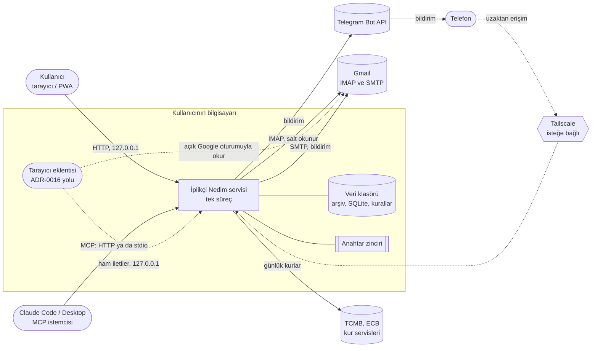
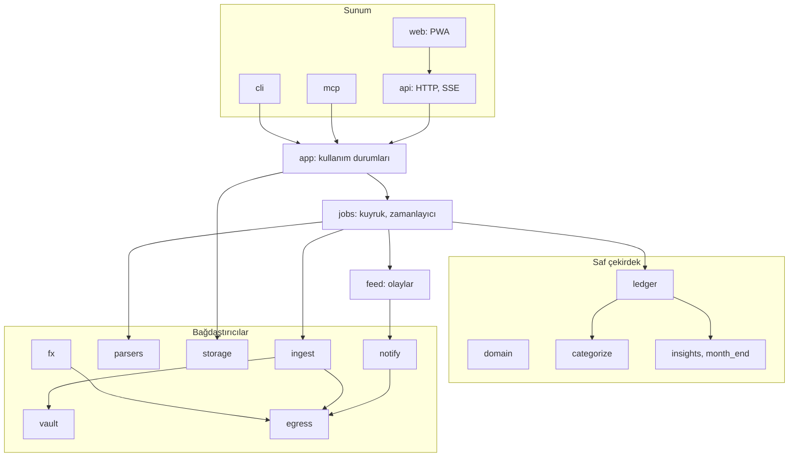
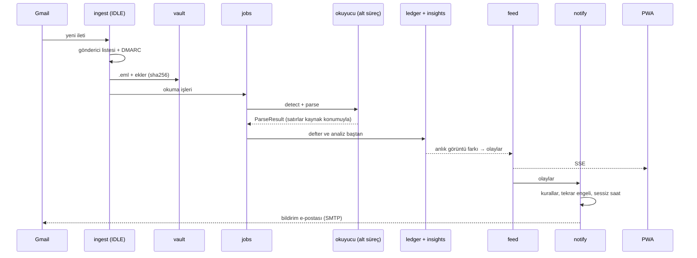
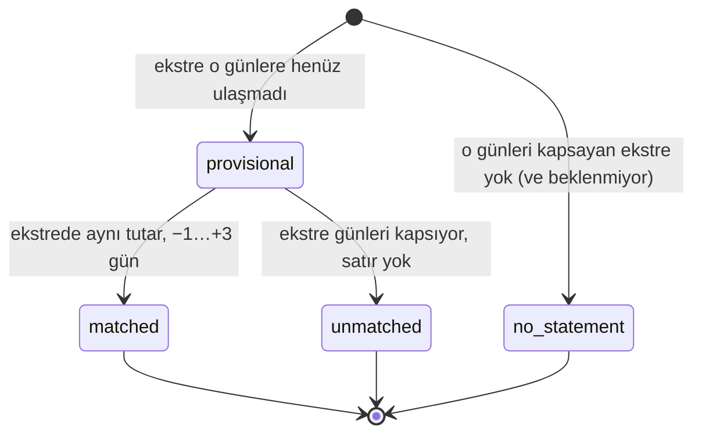

# V1 mimarisi

Proje: İplikçi Nedim · Durum: son hâli, uygulamaya hazır · Tarih: 2026-10-31 · İlgili belgeler:
[gereksinimler](requirements.md), [özellikler](features.md), [yol haritası](roadmap.md), [geçiş](migration.md),
[ADR'ler](../adr/README.md), [alan kuralları](../domain/)

Bu belge V1'in **hedef** mimarisidir. MVP'nin bugünkü yapısı [gereksinimler](requirements.md)'deki "Bugün"
bölümlerindedir; ikisi arasındaki yol [yol haritası](roadmap.md)'ndadır.

## 1. Özet

İplikçi Nedim, kullanıcının bilgisayarında sürekli çalışan **tek bir Python servisidir** (modüler monolit, ADR-0001).
Servis şu işleri yapar:

- Bankaların ve diğer güvenilen göndericilerin e-postalarını IMAP IDLE ile anında alır (ADR-0015). Uygulama şifresi
  olmayan hesaplar (Gelişmiş Koruma'daki Gmail) için yol, Gmail'in web arayüzünü kullanıcının açık oturumuyla okuyan
  İplikçi Nedim tarayıcı eklentisidir (ADR-0016). Elle eklenen belgeleri de kabul eder.
- Her belgeyi içerik adresli bir **arşivde** bir kez saklar (ADR-0003).
- Belgeleri eklenti **okuyucularla** alt süreçte okur (ADR-0005).
- Okunan satırları ve kullanıcı kararlarını **SQLite**'ta tutar (ADR-0004).
- Defteri ve yorumu her alım partisinden sonra baştan hesaplar.
- Değişiklikleri **olaylara** çevirir (ADR-0014). Olaylar anlık akışa (SSE), bildirim kurallarına (e-posta, Telegram,
  masaüstü; ADR-0010) ve MCP'ye (ADR-0011) gider.

Arayüz, servisin sunduğu bir React PWA'dır (ADR-0008). Bütün kişisel veri depo dışındaki veri klasöründe durur
(ADR-0002). Ağa yalnızca izin verilen işler için çıkılır (ADR-0009).

**Adlar:** ürün adı İplikçi Nedim, depo ve dağıtım adı `iplikci-nedim`. Teknik adların hepsi kısa adı kullanır:

- Python paketi ve komut `iplikci`; veri klasörü `iplikci/`; `IPLIKCI_*` ortam değişkenleri;
- `iplikci` anahtar zinciri hizmeti; `com.iplikci.*` servis etiketleri; `X-Iplikci` başlığı;
- `iplikci://` MCP kaynakları ve `iplikci.parsers` giriş noktası grubu.

Kısa adın gerekçeleri:

- Yazması kolaydır.
- PEP 8'in kısa paket adı önerisine uyar.
- Ürün adı yeniden değişse de veri yolları ve sırlar yerinde kalır.

## 2. Hedefler ve kısıtlar

İşlevsel gereksinimler [requirements.md](requirements.md) (G1–G13), ayrıntılı davranış [features.md](features.md)'dedir.

**İşlevsel olmayan hedefler**

| Ölçü | Hedef |
|---|---|
| Yeni banka e-postasının akışa düşmesi | ≤ 10 sn (IDLE bağlıyken); eklenti köprüsünde tarayıcı açıkken ≤ 5 dk (ADR-0016) |
| Elle eklenen tek belgenin akışa düşmesi | ≤ 5 sn |
| API yanıtı | p95 < 200 ms (10 bin işlemde) |
| Defteri ve analizi baştan hesaplamak | < 2 sn (10 bin işlemde) |
| Bütün arşivi yeniden okumak | < 60 sn (bugünkü ~150 belge MVP'de ~10 sn) |
| Servisin açılışı | < 5 sn |
| Bellek | < 500 MB (okuma alt süreçleri hariç) |
| Çalışma | bilgisayar uyanıkken; uykudan sonra kaçırılan işler tamamlanır |
| Kayıp toleransı (RPO) | belgeler: 0 (arşiv değişmez, Time Machine); kullanıcı kararları: ≤ 1 gün (günlük yedek) |
| Kurtarma (RTO) | veritabanını arşivden yeniden kurmak < 10 dk |

**Kesin kısıtlar**

- Platform: Windows, macOS ve Linux (K15). Son kullanıcı terminal kullanmaz (K14, ADR-0017). Metin tanıma (OCR)
  şimdilik yalnızca macOS'ta.
- Teknoloji ve dil: Python 3.13 + uv. Arayüz metinleri Türkçe; kod, yorum ve tanımlayıcılar İngilizce.
- Yalnızca kişisel para hareketleri işlenir; şirket belgeleri okunmaz, saklanmaz, raporlanmaz.
- Belgeler:
  - Kalıcı silme yoktur; sha256'sı farklı bir dosyanın üzerine yazılmaz.
  - Banka belgeleri ve e-postalar güvenilmez girdidir.
- Gizlilik:
  - Ağa yalnızca izin listesindeki işler için çıkılır (ADR-0009).
  - Depoda kişisel veri yoktur.
- Kapsam: hobi projesi, kurumsal ürün değil. Yine de her kullanıcıya hizmet eder ve kullanıcının kendine özgü
  bilgileri koda yazılmaz.

**Tercihler:** az bağımlılık, standart kütüphane önce, açıklanabilir kurallar, finanstan anlamayan kullanıcı için sade
dil.

## 3. Kapsam dışı

- Şirket belgeleri ve ticari hesaplar.
- Birden çok kullanıcı, hane paylaşımı (ileride).
- İnternet şubesine otomatik giriş ve ekran kazıma; açık bankacılık API'leri.
- Bulut eşitleme, sunucuya kurulum.
- Yapay zekâ asistanı ve strateji uzmanları (V2), yatırım tavsiyesi, vergi beyannamesi.

## 4. Seçenekler ve öneri

| Seçenek | Özü | Neden seçilmedi / seçildi |
|---|---|---|
| A — MVP'yi büyütmek | CLI, zamanlanmış görevler, tek dosyalık rapor | Anlık akış ve anında bildirim yapılamaz; panel eski kodla kalır; JSON önbellek notları taşıyamaz. |
| **B — Modüler monolit servis** | Tek süreç, SQLite, içerik adresli arşiv, PWA | **Seçildi:** gereksinimlerin hepsini en az parçayla karşılar (ADR-0001). |
| C — Çok servisli yapı | API, işçi, Redis, Postgres, Docker | Tek kullanıcı için işletim yükü; Docker içinden anahtar zinciri ve OCR'ye erişim zor. |

Önerinin değişeceği durum: birden çok kişinin birden çok cihazdan aynı anda yazması (sunucu, Postgres, kullanıcı
hesapları).

## 5. Sistem bağlamı



Gösterim: dikdörtgen bizim sürecimiz, silindir veri ya da dış servis, kesikli çizgi isteğe bağlı bağlantı. Oklar
bağlantıyı kimin başlattığını gösterir; Telegram bağlantısını da servis başlatır (uzun yoklama).

## 6. Bileşenler



Python paketi `iplikci`, `src/iplikci/` altındadır:

| Modül | Sorumluluk |
|---|---|
| `domain` | Modeller, `Money` ve `Quantity`, kodlar ve Türkçe etiketleri, saf yardımcılar. Hiçbir iç modüle bağlı değildir. |
| `settings` | Veri klasörünü bulmak, `settings.toml`, anahtar zinciri, ortam değişkenleri. |
| `storage` | SQLite bağlantısı, göçler, depo modülleri, FTS. |
| `vault` | Nesne deposu, `staging`, türetilmiş veriler, çöp kutusuna taşıma, bütünlük denetimi. |
| `ingest` | E-posta bağlayıcıları (IMAP IDLE ve tarayıcı eklentisi köprüsünün alım ucu, ADR-0016) ve güven kuralı; yükleme; gelen klasörü; içe aktarma; zip ve mbox açma. |
| `parsers` | Kayıt defteri, sözleşme, okuyucular; PDF, tablo, HTML ve e-posta yardımcıları; OCR. |
| `ledger` | Birleştirme, maskeli hesap çözümü, kanıt uzlaştırma, transferler, kur çevirisi, fatura eşleştirme, kapsama. |
| `categorize` | Kural katmanları, eşleştirme, gereklilik, kural dosyasını doğrulayarak düzenleme. |
| `insights` | Bulgular, düzenli ve dönemsel ödemeler, alışkanlıklar, tahmin, varlıklar, nakit akışı öngörüsü. |
| `month_end` | Ay kapanışı. |
| `fx` | Kur sağlayıcıları, kur seçimi, enflasyon serileri. |
| `feed` | Olay kaydı, anlık görüntü farkı, SSE yayını. |
| `notify` | Bildirim kural motoru, kanallar, teslim kaydı. |
| `jobs` | İş kuyruğu, zamanlayıcı, işçiler. |
| `egress` | İzin verilen dış bağlantılar (ADR-0009). |
| `app` | Kullanım durumları (e-postayı şimdi al, planla, uygula, not ekle…); `api`, `mcp` ve `cli`'nin ortak giriş noktası. |
| `api` | FastAPI uygulaması, kimlik doğrulama, SSE, PWA dosyaları. |
| `mcp` | MCP sunucusu ve stdio köprüsü. |
| `cli` | Kullanıcı ve geliştirici komutları. |
| `export` | CSV, XLSX, tek dosyalık HTML rapor, ay sonu sayfaları. |
| `service` | Süreç başlatma, servis yöneticisi entegrasyonu, tek kopya kilidi, yaşam döngüsü. |
| `web/` (depo kökünde) | PWA; ayrı bir TypeScript projesi. |
| `extension/` (depo kökünde) | Tarayıcı eklentisi (Chromium, Manifest V3); ayrı bir TypeScript projesi (ADR-0016). |

**Bağımlılık kuralları**

- `domain` hiçbir iç modülü içe aktarmaz.
- `ledger`, `categorize`, `insights` ve `month_end` yalnızca `domain`'i ve birbirlerini kullanır. Veritabanına, dosyaya
  ya da ağa dokunmazlar.
- Sunum (`api`, `mcp`, `cli`) yalnızca `app`'i kullanır.
- Ağa yalnızca `egress` çıkar.
- Bu kurallar import-linter benzeri bir testle denetlenir.

## 7. Akışlar

**Bankadan e-posta geldiğinde**



**Elle ekleme:** yükleme, `staging`'e yazılır ve okunur; kullanıcıya plan gösterilir (hangi belge, hangi hesap, ne
olacak); kullanıcı onaylayınca arşive alınır. Gelen klasörüne bırakılan dosyalar klasör 20 sn sessiz kalınca aynı
yoldan, onaysız alınır. MCP'den içe aktarma planı Claude'un kullanıcıya göstermesi için döner.

**Okuyucu güncellemesi:** açılışta kayıt defterindeki sürümler okunan belgelerinkilerle karşılaştırılır; değişen
okuyucunun belgeleri ve işlenmeyen belgeler yeniden okunur; defter baştan hesaplanır; değişen satırlar olay olur.

**Kullanıcı düzeltmesi:** kategori ya da not değişikliği işlemin parmak izine yazılır; kural olarak kaydedilirse
`rules/personal.yaml` doğrulanarak güncellenir, önceki sürüm `rules/history/`'ye alınır; etkilenen işlemler gösterilir.

## 8. Veri modeli

| Varlık (tablo) | Sınıf | İçerik |
|---|---|---|
| `documents` | üst veri (asıl kaynak arşivde) | sha256, tür, banka, durum, neden, okuyucu ve sürümü, doğrulama, dönem, görünen ad, üst belge (e-posta) |
| `document_sources` | asıl | kaynak türü (`email`, `upload`, `inbox`, `import`), Message-ID, gönderen, tarih, konu, özgün ad, zaman |
| `accounts` | türev + kullanıcı etiketi | banka, tür, para birimi, numara (maskeli gösterilir), takma ad |
| `statements` | türev | tür, dönem, kesim, önceki ve son bakiye, satır satır kontroller, doğrulama, son ödeme tarihi, asgari ödeme, limit |
| `transactions` | türev | tarih, tutar (en küçük birim), para birimi, tür, açıklama, karşı taraf, taksit, orijinal tutar, kesinlik, kaynak konumu, parmak izi |
| `evidence` | türev | dekont ve banka bildirimi satırları, uzlaştırma durumu, eşleştiği satır |
| `invoices` | türev | banka dışı e-postalar: satıcı, tutar, tarih, son ödeme tarihi, kalemler, eşleştirme durumu |
| `links` | türev | transfer eşleri, kanıt↔satır, fatura↔satır |
| `annotations` | **birincil** | parmak izine bağlı not, etiket, kategori ve gereklilik düzeltmesi, bölme |
| `analysis_snapshots` | türev | yorum, düzenli ödemeler, alışkanlıklar, tahmin, varlıklar, ay kapanışları (JSON) |
| `fx_rates` | dış kaynak | tarih, döviz çifti, alış ve satış, kaynak |
| `events` | **birincil** (günlük) | tür, zaman, yük, ilgili kimlikler |
| `jobs`, `deliveries` | işletim | iş kuyruğu; gönderilen bildirimler |
| `mail_accounts` | işletim | adres, klasör, UIDVALIDITY, son UID, başlangıç günü, son hata |
| `audit_log` | **birincil** (günlük) | kim (kullanıcı, MCP, sistem, taşıma), ne, ne zaman, hedef |

Kategori ve bildirim kuralları veritabanında değil, veri klasöründeki YAML dosyalarındadır (§20).

**Kimlikler**

- Belge kimliği: sha256.
- İşlem satırı kimliği: belge sha256 + okuyucu kimliği + satır sırası.
- İşlemin **parmak izi**: (hesap, tarih, tutar, para birimi, sadeleştirilmiş açıklama, aynı satırlar arasındaki sıra).
  Notlar ve düzeltmeler parmak izine bağlanır; böylece yeniden okumada kaybolmazlar. Yeniden okumadan sonra eşi
  bulunamayan not "yetim" olarak Yapılacaklar'a düşer.
- Aynı gün aynı tutarlı satırların hepsi gerçektir; sıra numarası bu yüzden parmak izinin parçasıdır.
- Parmak izi, satır okuyucunun okuduğu haliyle alınır: açıklama yeniden yazılmadan, döviz tutarı TL'ye çevrilmeden
  önce. Açıklamanın yalnızca harf ve rakamları sayılır; para birimi ISO koduyla yazılır.
- Aşama 1'de parmak izi defter kurulurken bellekte hesaplanır; `transactions` tablosunda tutulmaz. Sıra numarası
  bütün belgelerin satırlarına göre verildiği için tek bir belge okunurken bilinemez.
- Bir ekstrenin doğruladığı dekont satırı defterden çıkar; notu ekstre satırına geçer.

**Kesinlik**

Her işlem ve toplam bir kesinlik taşır:

| Kod | Anlamı | Toplamlara girer mi? |
|---|---|---|
| `confirmed` | Ekstre ya da döküm satırı. | Evet. |
| `provisional` | Ekstresi henüz gelmemiş günlerdeki dekont ya da banka bildirimi. | Evet; "geçici" etiketiyle. |
| `excluded` | Ekstre o günleri kapsıyor ama satırı göstermiyor. | Hayır; işaretlenir. |
| `info` | Eşleşmeyen banka dışı e-posta. | Hayır; bilgi olarak görünür. |

Kanıtların (dekont ve banka bildirimi) yaşam döngüsü:



Durumların kuralları [domain/ledger.md](../domain/ledger.md)'dedir.

## 9. Veri klasörü

```text
~/Library/Application Support/iplikci/     (IPLIKCI_HOME ile değiştirilebilir; Linux ve Windows: ADR-0002)
├── settings.toml          # ayarlar; sır içermez
├── iplikci.db             # SQLite (WAL)
├── vault/
│   ├── objects/ab/cd/<sha256>   # asıllar, değişmez, salt okunur
│   ├── staging/                 # okunmakta olan, kalıcı değil
│   └── derived/<sha256>/        # sayfa resimleri, metin, kelime kutuları (yeniden üretilebilir)
├── rules/
│   ├── personal.yaml      # kişisel kategori kuralları ve kararlar (kira, aile, _biten, …)
│   ├── alerts.yaml        # bildirim kuralları
│   └── history/           # her değişiklikten önceki sürüm
├── inbox/                 # izlenen gelen klasörü
├── exports/               # CSV, XLSX, tek dosyalık rapor, ay sonu sayfaları
├── backups/               # günlük tutarlı yedekler (yer ayarlanabilir)
├── logs/                  # JSON günlükler, dönerek
├── baseline.json          # doğrulama tabanı (iplikci dogrula --taban)
├── archive/mvp/           # MVP'nin kodu, testleri, kuralları ve ayarları (2026-10-31); salt başvuru, V1 okumaz
└── run/                   # kilit, servis durumu
```

Klasörün izni 0700, dosyalarınki 0600'dür. Uygulamayla gelen genel kategori kuralları paketin içindedir
(`iplikci/rules/default.yaml`) ve kişisel kurallar onların üstüne biner.

## 10. Okuyucular

Sözleşme, seçim, sürüm ve yalıtım ADR-0005'tedir. Her okuyucu `src/iplikci/parsers/<banka>/<belge>.py` modülündedir:
kimlikteki nokta klasörü ayırır (`garanti.bonus_card` → `parsers/garanti/bonus_card.py`). Başlangıçtaki eklentiler
MVP'nin okuyucularından çıkar:

| Kimlik | Belge | MVP'deki yeri |
|---|---|---|
| `garanti.bonus_card` | Bonus kredi kartı ekstresi (PDF) | `parsers/garanti.py` |
| `garanti.paracard` | Paracard banka kartı cetveli (PDF) | `parsers/garanti.py` |
| `garanti.account_xls` | Hesap hareketleri (XLS) | `parsers/hesaplar.py` |
| `garanti.receipt` | Dekont (PDF) | `parsers/garanti_dekont.py` |
| `garanti.brokerage` | Yatırım hesabı ekstresi, işlem sonuç formu (PDF) | `parsers/garanti_yatirim.py` |
| `isbank.maximum_card` | Maximum kart hesap özeti (PDF) | `parsers/isbank.py` |
| `isbank.account_xls` | Hesap özeti (XLS) | `parsers/hesaplar.py` |
| `isbank.receipt` | FAST/EFT dekontu (PDF) | `parsers/isbank_dekont.py` |
| `isbank.passbook` | e-cüzdan (PDF) | `parsers/isbank_cuzdan.py` |
| `teb.bonus_card` | Bonus kart ekstresi (PDF; sayfa resmi olanlar OCR ile) | `parsers/teb.py` |
| `teb.card_payment_receipt` | Kart ödeme dekontu (PDF) | `parsers/teb.py` |
| `teb.account_html` | Hesap hareketleri (`.xls` adlı HTML) | `parsers/hesaplar.py` |
| `qnb.card_pdf` | Kredi kartı ekstre hareketleri (PDF) | `parsers/qnb_pdf.py` |
| `qnb.account_pdf` | Ek hesap / hesap hareketleri (PDF) | `parsers/qnb_pdf.py` |
| `qnb.edekont` | e-dekont (HTML, PDF) | `parsers/qnb.py` |
| `vakifbank.account_xlsx` | Hesap hareketleri (XLSX) | `parsers/hesaplar.py` |
| `vakifbank.passbook` | e-cüzdan (PDF) | `parsers/vakifbank_cuzdan.py` |

V1'de eklenen aileler: banka bildirimleri (`<banka>.notice.*`), kart ekstrelerinde son ödeme tarihi, asgari ödeme ve
limit alanları, banka dışı göndericiler (`invoice.ubl_tr`, `receipt.<kurum>`, `bill.<kurum>`). Liste
[features.md F01, F14](features.md)'tedir. Banka biçimlerinin bilinen tuzakları
[domain/bank-formats.md](../domain/bank-formats.md)'dedir.

Her satırın kaynağı (`SourceRef`) okuyucu çıktısında zorunludur:

- PDF'de sayfa ve satırın kutusu (x0, top, x1, bottom); metni satır satır okuyan okuyucularda sayfa ve satır numarası.
- Tabloda sayfa adı ve satır numarası; HTML tablosunda sayfa adı boştur.
- HTML belgede ve e-postada metindeki aralık (başlangıç, bitiş).

Konum veritabanında satırla birlikte JSON olarak durur (`transactions.ref`, `evidence.ref`).

Okuma kalıcı bir alt süreçte yapılır (`parsers/worker.py`); sonuç JSON olarak döner ve her değerin türü denetlenir. Bir
okuyucu belgesini tanıyıp okuyamazsa ya da okuduğu ekstre doğrulanmazsa okuma işi `parser.format_alarm` olayını yazar
(§13). Her okuyucunun sahte belgeleri `iplikci.fakes` paketindedir; `iplikci dev parser probe | debug | test`
okuyucuları geliştiricinin sürecinde dener.

## 11. Defter ve kesinlik

Defter, okunan satırlardan her seferinde baştan kurulur. Adımlar sırayla:

1. Bir ekstrenin birden çok dosyası, (hesap, kesim, para birimi, başlangıç) üzerinden birleştirilir; satırı çok olan
   kopya kalır. Bir ekstrenin içindeki satırlar asla tekilleştirilmez.
2. Maskeli hesap numaraları tek bir hesaba bağlanır.
3. Kanıtlar (dekont, banka bildirimi) ekstrelerle uzlaştırılır (§8, durum makinesi).
4. Transferler çözülür: kendi hesaplar, kurallar, karşı satırlar, kişiler.
5. Dövizli satırlar çevrilir: belgedeki kur, yoksa TCMB/ECB kuru (§15). Kurun kaynağı satırda saklanır.
6. Banka dışı faturalar banka satırlarıyla eşleştirilir (`matched`, `pending`, `unmatched`).
7. Hesap ve ay başına kapsama hesaplanır.
8. Kategoriler, işyerleri ve gereklilik atanır.

Kuralların tamamı [domain/ledger.md](../domain/ledger.md) ve
[domain/categorization.md](../domain/categorization.md)'dedir.

## 12. Yorum, ay sonu ve öngörüler

MVP'nin yorum ve ay sonu kuralları aynen korunur ([domain/interpretation.md](../domain/interpretation.md)). Kuralların
özü: yalnızca tam aylar, düzensiz harcamayı yıllığa çevirmemek, her bulgunun penceresi ve rakamı.

**V1'de eklenenler**

- Dönemsel seriler (~182 ve ~365 gün).
- Son ödeme tarihleri ve asgari tutarlar.
- Nakit akışı öngörüsü (hesap başına gün gün bakiye).
- Borç görünümü.
- Olağan dışı hareketler.
- Kur makası maliyeti, döviz gelirinin etkisi, çoklu para birimiyle varlıklar.

**V1+ olarak eklenecekler**

- Enflasyondan arındırma.
- Bütçe ve hedefler.
- Senaryolar.
- Kişiler arası borç-alacak.
- Nakit cüzdanı.

Çıktılar `analysis_snapshots`'ta sürümlenir; API ve MCP son anlık görüntüyü okur.

## 13. Olaylar ve anlık akış

Her analizden sonra yeni anlık görüntü öncekiyle karşılaştırılır; fark olaylara dönüşür. Olaylar `events` tablosuna
yazılır (ADR-0014), SSE ile arayüze iletilir ve bildirim kurallarına girer.

| Olay | Ne zaman |
|---|---|
| `document.received`, `document.processed`, `document.unprocessed`, `document.unreadable` | belge geldi / okundu / tanınmadı / okunamadı |
| `transaction.created`, `transaction.confirmed` | yeni satır; geçici satır ekstreyle kesinleşti |
| `evidence.unmatched` | dekont ya da bildirim, kapsayan ekstrede yok |
| `invoice.matched`, `invoice.pending`, `invoice.unmatched` | banka dışı e-postanın eşleştirme sonucu |
| `payment.due_soon` | son ödeme ya da beklenen ödeme yaklaşıyor |
| `expected_payment.missing` | beklenen düzenli ya da dönemsel ödeme görünmedi |
| `balance.forecast_negative` | öngörüde hesap eksiye düşüyor |
| `transaction.large` | büyük tek seferlik harcama |
| `subscription.price_changed`, `subscription.paid_after_cancel` | zam; iptalden sonra ödeme |
| `income.received`, `income.late` | maaş ya da düzenli gelir geldi / gecikti |
| `month.ended`, `month.closed`, `month.needs_check` | ay bitti / kapandı / kontrol gerekli |
| `deposit.maturity_soon` | vadeli hesabın vadesi yaklaşıyor |
| `fx.threshold_crossed`, `budget.threshold` | kur eşiği; bütçe %80 / %100 (V1+) |
| `parser.format_alarm`, `mail.auth_failed`, `mail.bridge_alarm`, `mail.bridge_silent`, `backup.failed` | sistem olayları: okuyucu biçim alarmı; e-posta girişi reddedildi; eklentinin bir katmanı Gmail'in sayfasını tanımadı; eklenti bir gündür görünmedi; yedek alınamadı |
| `bridge.paired`, `bridge.revoked` | tarayıcı eklentisi eşleşti / eşleşmesi iptal edildi (denetim kaydına da yazılır) |

Akış ekranı bu olayları ve "şu an" özetini (tahmini bakiyeler, ay içi tempo, beklenen olaylar) gösterir.

## 14. Bildirimler

Kanallar, ayrıntı düzeyleri ve teslim kuralları ADR-0010'dadır. Kurallar `rules/alerts.yaml` dosyasındadır. Dosya
kullanıcıya açık olduğu için anahtarları Türkçedir:

```yaml
- ad: Son ödemeye 3 gün            # arayüzde görünen ad
  olay: payment.due_soon            # olay kodu (§13)
  kosul: {gun: 3}
  kanallar: [masaustu, telegram]
  ayrinti: ozet                     # tam | ozet | asgari
- ad: Büyük harcama
  olay: transaction.large
  kanallar: [masaustu]
```

Hazır kurallar baştan açıktır; kurulum sihirbazı Telegram ya da e-posta bağlanınca hangilerinin oraya da gideceğini
sorar:

- son ödemeye 3 gün,
- hesap eksiye düşecek,
- büyük harcama,
- abonelik zammı,
- iptalden sonra ödeme,
- beklenen ödeme gelmedi,
- maaş gecikti,
- ay kapandı / kontrol gerekli,
- ekstrede görünmeyen dekont,
- e-posta girişi reddedildi,
- okuyucu biçim alarmı,
- yedek alınamadı.

## 15. Döviz

| Kaynak | Ne için | Not |
|---|---|---|
| Belgedeki kur | o işlemin kendisi | bankanın uyguladığı gerçek kur; her zaman önce gelir |
| TCMB günlük kurları | belgede kur yoksa; varlık değerleme; makas karşılaştırması | resmî, ücretsiz, anahtarsız; iş günleri öğleden sonra yayımlanır |
| ECB ya da Frankfurter | TCMB'ye ulaşılamazsa | EUR bazlı, TRY dahil |
| TCMB EVDS (isteğe bağlı) | TÜFE (enflasyondan arındırma), altın | ücretsiz kayıt ve API anahtarı gerekir |

- Kurlar `fx_rates`'te tarihçeli saklanır. Hafta sonu ve tatil için önceki iş gününün kuru kullanılır.
- Kurulumda verinin kapsadığı tarihler için geçmiş kurlar bir kez çekilir; sonra her iş günü 16:30'dan sonra çekilir.
- Değerleme yönleri:
  - Varlıklar döviz alış kuruyla değerlenir, borçlar satış kuruyla.
  - Kur makası, işlemin yönüne uygun TCMB kuruyla karşılaştırılır. Örneğin kullanıcı EUR bozduruyorsa banka kuru,
    TCMB döviz alış kuruyla karşılaştırılır.
- Ağ yoksa belgedeki kurlar kullanılır; ekranda kurun tarihi yazar.
- Altın fiyatı için ücretsiz ve güvenilir bir kaynak doğrulanana dek altın, gram ve maliyetiyle gösterilir.

## 16. API

| Yol | Amaç |
|---|---|
| `GET /api/status` | servis, e-posta, kuyruk, son analiz |
| `GET /api/events/stream`, `GET /api/events` | SSE olay akışı (`Last-Event-ID` ile kaldığı yerden); olay kaydı, sayfalı |
| `GET /healthz` | servis ayakta mı; kimlik istemez |
| `GET /giris`, `POST /api/login-links`, `POST /api/logout` | tek kullanımlık giriş bağlantısı, oturum çerezine döner; çıkış (ADR-0007) |
| `GET /api/labels` | kodların Türkçe adları, tek eşleme modülünden |
| `GET /api/feed` | akış (sayfalı, süzgeçli) |
| `GET /api/dashboard` | pano özetleri |
| `GET /api/accounts`, `GET /api/accounts/{id}` | hesap haritası; hesap ayrıntısı (akış, bakiye eğrisi, türe özel alanlar) |
| `GET /api/transactions`, `GET /api/transactions/{fp}` | liste ve arama; ayrıntı ve "neden?" |
| `PUT /api/transactions/{fp}/annotation` | not, etiket, düzeltme, bölme |
| `GET /api/documents`, `GET /api/documents/{id}` | arşiv listesi ve ayrıntısı |
| `GET /api/documents/{id}/pages/{n}.png`, `GET /api/documents/{id}/download` | sayfa resmi; aslını indirme |
| `POST /api/documents/{id}/reparse`, `POST /api/documents/{id}/remove` | yeniden okuma; çöp kutusuna taşıma |
| `POST /api/uploads`, `POST /api/inbox/plan`, `POST /api/inbox/apply` | elle ekleme (plan → onay → uygula) |
| `GET /api/subscriptions`, `/api/calendar`, `/api/forecast`, `/api/insights`, `/api/holdings`, `/api/fx` | analizler |
| `GET /api/month-end`, `GET /api/month-end/{YYYY-MM}` | ay kapanışı |
| `GET/PUT /api/rules/categories`, `POST /api/rules/categories/preview` | kategori kuralları ve önizleme |
| `GET/PUT /api/rules/alerts`, `GET /api/notifications` | bildirim kuralları ve geçmişi |
| `GET /api/mail`, `POST /api/mail/fetch` | e-posta durumu; şimdi al |
| `POST /api/bridge/pairings`, `POST /api/bridge/pair`, `GET /api/bridge/hello`, `GET /api/bridge`, `DELETE /api/bridge/{id}` | tarayıcı eklentisi: eşleştirme kodu, kodun belirtece dönmesi, servisin kanıtı (HMAC), eşleşmeler, iptal (ADR-0016) |
| `GET /api/ingest/mail/cursor`, `POST /api/ingest/mail`, `POST /api/ingest/mail/known`, `POST /api/ingest/mail/alarm` | eklentinin konumu, ham iletilerin teslimi, taramanın bulduğu iletilerden eksik olanlar, bir katmanın biçim alarmı; yalnızca eklenti belirteciyle |
| `GET/PUT /api/settings` | ayarlar (sır içermez) |
| `GET /api/system` | sağlık, işler, okuyucu sağlığı, yedekler |
| `GET /api/backups`, `POST /api/backups` | yedekler; şimdi yedek al |
| `POST /api/exports` | CSV, XLSX, tek dosyalık rapor, ay sonu sayfaları |
| `/mcp` | MCP Streamable HTTP |

Kimlik doğrulama ve istek güvenliği ADR-0007'dedir. Liste uçları imleçle sayfalanır; tutarlar en küçük birim ve para
birimiyle döner, biçimlendirme arayüzdedir.

## 17. MCP

Taşıma, kaynaklar ve hazır istemler ADR-0011'dedir. Araçlar:

| Araç | Yazar mı? | İş |
|---|---|---|
| `status` | – | durum, eksik belgeler, e-posta |
| `import_documents` | plan | verilen yollardan belge ekleme planı |
| `fetch_email` | evet | e-postayı şimdi al |
| `plan_inbox`, `apply_inbox` | plan / evet | gelen klasörü planı ve uygulaması |
| `build_report` | evet | dışa aktarımları üret |
| `insights`, `regular_payments`, `habits`, `accounts`, `month_end`, `transactions` | – | MVP araçları (yeni yapıyla) |
| `read_rules`, `add_rule`, `mark_ended`, `write_rules` | evet (kurallar) | kategori kuralları; fark ve etkilenen işlemler döner |
| `search` | – | işlemlerde ve belge metninde tam metin arama |
| `explain_transaction` | – | işlemin belgesi, sayfası, kuralı, eşleşmeleri, kuru |
| `get_document` | – | belge üst verisi, metni, sayfa bağlantıları |
| `unprocessed_documents` | – | işlenmeyen ve okunamayan belgeler, nedenleriyle |
| `reparse_document` | evet | bir belgeyi yeniden okut |
| `feed` | – | anlık akış |
| `accounts_overview` | – | hesap haritası, türe göre toplamlar |
| `upcoming_payments`, `cash_flow_forecast` | – | takvim; hesap başına bakiye öngörüsü |
| `subscriptions` | – | abonelikler, düzenli ve dönemsel ödemeler |
| `net_worth`, `fx_rates` | – | varlıklar (TL, EUR, USD, altın); kurlar |
| `alerts` | evet | bildirim kurallarını listele, ekle, kapat |
| `annotate_transaction` | evet | not, etiket, düzeltme |

## 18. Ön yüz

Teknoloji ADR-0008'dedir. Ekranlar ve davranışları [features.md](features.md)'dedir.

- **Ekranlar ve yollar:**
  - `/akis`
  - `/` (pano)
  - `/hesaplar`, `/hesaplar/:id`
  - `/islemler`
  - `/belgeler`, `/belgeler/:id`
  - `/abonelikler`
  - `/takvim`
  - `/degerlendirme`
  - `/ay-sonu/:ay`
  - `/doviz`
  - `/bildirimler`
  - `/kurallar`
  - `/yapilacaklar`
  - `/sistem`
  - `/kurulum`
  - `/ayarlar`
- **Veri:** TanStack Query; SSE bir olay alınca ilgili sorguları geçersiz kılar. Arayüzde iyimser güncelleme yalnızca
  notlarda ve etiketlerde vardır.
- **Belge görüntüleyici:**
  - PDF sayfaları sunucuda PNG'ye çevrilir; satırın kutusu üstüne vurgu olarak çizilir.
  - Tablo dökümlerinde satır, tabloda vurgulanır.
  - E-posta önce metin olarak gösterilir. "Özgün görünüm" seçilirse betiksiz, uzak içeriksiz bir `sandbox` çerçevede
    açılır.
  - Ham PDF ya da HTML uygulamanın kendi kökeninde açılmaz.
- **Görünüm:**
  - Açık ve koyu tema.
  - "Sade" ve "Ayrıntılı" görünüm.
  - Terimler sözlüğü (üzerine gelince açıklama).
  - Durum renkleri her zaman ikon ve etiketle.
  - Klavyeyle kullanım; WCAG AA kontrast.

## 19. Servis ve işletim

**Kurulum ve güncelleme** (ADR-0017)

- Son kullanıcı işletim sistemine uygun kurulum paketini açar. Uygulama arka plan servisini kaydeder ve kurulum
  sihirbazını tarayıcıda açar; terminal gerekmez.
- Servis biçimleri:
  - macOS: `com.iplikci.service` oturum ajanı (`RunAtLoad`, `KeepAlive`),
  - Windows: oturum açılışında başlayan görev,
  - Linux: kullanıcı systemd birimi.
- Servis kurulu sürümü çalıştırır, geliştirme klasörünü asla çalıştırmaz.
- Güncellemek için yeni paket açılır; servis yeni sürümle yeniden başlar.
- Geliştiriciler servisi `uv run iplikci servis calistir` ile ön planda çalıştırır.
- Tek kopya kilidi veri klasöründedir.

**Komutlar**

Komutlar geliştiriciler ve isteyen kullanıcılar içindir; her kullanıcı komutunun arayüzde bir karşılığı vardır (K14).
Kullanıcı komutları Türkçedir; geliştirici komutları `dev` altında İngilizcedir.

| Komut | İş |
|---|---|
| `iplikci kur` | kurulum sihirbazını açar |
| `iplikci ac` | arayüzü tek kullanımlık giriş bağlantısıyla açar |
| `iplikci servis kur \| kaldir \| durum \| yeniden-baslat \| calistir` | arka plan servisi (`calistir` ön planda çalıştırır) |
| `iplikci eposta kur \| durum \| kaldir` | e-posta bağlantısı; şifre gizli istemle girilir, hiçbir yere yazılmaz |
| `iplikci telegram kur \| kaldir` | bot belirteci ve sohbet eşleştirmesi |
| `iplikci ekle <yol>…` | belge ekleme planı ve onay |
| `iplikci dogrula [--taban] [--arsiv] [--yeniden-kur]` | doğrulama tabanı; arşiv bütünlüğü; veritabanını yeniden kurma |
| `iplikci yedek al \| geri-yukle <dosya>` | yedek |
| `iplikci disa-aktar csv \| xlsx \| rapor \| ay-sonu` | dışa aktarım |
| `iplikci mcp` | MCP stdio köprüsü |
| `iplikci dev demo \| parser probe \| parser debug \| parser test` | geliştirici araçları |

**Yedek**

- Her gün bir yedek alınır:
  - SQLite'ın çevrimiçi yedek API'siyle veritabanının tutarlı bir kopyası,
  - kurallar,
  - kullanıcı kararlarının JSON dökümü,
  - ayarlar.
- Arşiv nesneleri değişmediği için artımlı kopyalanır.
- Yedekler `backups/` altına yazılır ve 14 gün saklanır. Diskte şifreleme FileVault'a, harici yedekte Time Machine'in
  şifreli yedeğine bırakılır. Uygulama düzeyinde şifreli dışa aktarma V1+ özelliğidir.
- Geri yükleme ayda bir prova edilir (`iplikci dogrula --yeniden-kur` ile aynı denetimler).

**Uyku ve uyanma:** IDLE bağlantısı koptuğunda bekleme süresi her denemede artar; uyanınca kaçırılan işler bir kez
çalışır.

## 20. Ayarlar ve sırlar

`settings.toml` veri klasöründedir. Kişisel bilgiler (ad, şirket adları, e-posta adresi) içerebilir, sır içermez.

```toml
[identity]
names = ["Ad Soyad"]                # kendi transferlerini tanımak için
business_names = ["ŞİRKET ADI"]     # genel işaretlere ek şirket belgesi işaretleri

[server]
port = 8643
remote = "off"                      # "tailscale"

[mail]
address = "kullanici@example.com"
connector = "imap"                  # ya da "browser_bridge" (ADR-0016)
imap_host = "imap.gmail.com"
folder = "auto"                     # Gmail'de Tüm Postalar
start_day = 2024-01-01
bank_senders = ["garantibbva.com.tr", "isbank.com.tr", "teb.com.tr", "qnb.com.tr", "vakifbank.com.tr"]
other_senders = []                  # fatura, abonelik, e-ticaret göndericileri
smtp_host = "smtp.gmail.com"        # yalnızca uygulama şifresine izin veren hesaplarda

[notify]
quiet_hours = "23:00-08:00"
detail = {email = "full", telegram = "summary", desktop = "summary"}

[fx]
providers = ["document", "tcmb", "ecb"]

[privacy]
mcp_masking = "off"                 # "accounts" | "accounts_and_names"

[backup]
keep_days = 14
```

| Sır | Yeri |
|---|---|
| E-posta uygulama şifresi (yalnızca `imap` bağlayıcısında) | anahtar zinciri: hizmet `iplikci`, hesap `mail:<adres>` |
| Telegram bot belirteci | anahtar zinciri: `telegram-bot` |
| Tarayıcı eklentisi belirteci | servis yalnızca özetini tutar; eklenti kendi yerel deposunda (`chrome.storage.local`) |
| API belirteci (CLI, MCP) | anahtar zinciri: `api-token` |
| EVDS anahtarı (isteğe bağlı) | anahtar zinciri: `evds` |

Masaüstü olmayan Linux'ta sırlar `IPLIKCI_MAIL_PASSWORD` ve benzeri ortam değişkenlerinden okunur. Hiçbir sır dosyaya,
komut satırı argümanına ya da günlüğe yazılmaz.

## 21. Güvenlik

| Tehdit (STRIDE) | Örnek | Önlem |
|---|---|---|
| Kimlik taklidi | Bankayı taklit eden e-posta | Gönderici listesi + DMARC pass |
| Kimlik taklidi | Başka bir site ya da kullanıcının API'ye erişmesi | 127.0.0.1, Host izin listesi, çerez ve belirteç, Origin denetimi |
| Kimlik taklidi | 127.0.0.1:8643'te başka bir sürecin dinlemesi; eklentinin iletileri ona göndermesi | Eşleştirmede paylaşılan sır; eklenti göndermeden önce servisin sırrı bildiğini doğrular |
| Kurcalama | Arşivdeki dosyanın değişmesi | İçerik adresi, salt okunur dosya izni, `dogrula --arsiv` |
| Kurcalama | Bozuk kural dosyası | Yazmadan önce doğrulama; önceki sürüm `history/`'de |
| İnkâr | Kim neyi değiştirdi? | `audit_log` (kullanıcı, MCP, sistem, taşıma) |
| Bilgi sızması | Depo, günlük, bildirim, model | Veri depo dışında; günlükte kimlik ve sayı, değer yok; bildirim ayrıntı düzeyi; MCP maskeleme; çıkış izin listesi |
| Bilgi sızması | Belgedeki betik | PDF resim olarak, HTML metin ya da betiksiz çerçevede gösterilir; CSP |
| Bilgi sızması | Eklentinin Gmail'e geniş erişimi | En az izin (yalnızca `mail.google.com` ve 127.0.0.1); yalnızca okuma istekleri; uzaktan yüklenen kod yok; yalnızca listedeki göndericiler; açık kaynak |
| Hizmet engelleme | Dev ya da kötü niyetli belge | Alt süreçte süre ve bellek sınırı; boyut sınırları; zip bombasına karşı üye sınırı |
| Yetki yükseltme | Belgedeki "talimat" | Belge metni veridir; yazan araçlar yalnızca kullanıcı onayıyla; `eval`, `shell=True` yok |
| Yetki yükseltme | Eklenti belirtecinin çalınması | Belirteç yalnızca e-posta alım ucuna yetkili; arayüzden iptal edilir |

Bağımlılıklar kilit dosyasıyla sabitlenir; CI'da güvenlik açığı taraması (pip-audit, `npm audit`) ve gitleaks çalışır.

## 22. Gözlemlenebilirlik

- **Günlük:**
  - JSON biçiminde ve dönerek tutulur (5 × 10 MB).
  - Yalnızca kimlikler ve sayılar yazılır; tutar, ad, adres ve açıklama yazılmaz.
- **Durum ve ölçüler:** `/api/system` ve Sistem ekranı şunları gösterir:
  - son başarılı e-posta alımı,
  - kuyruk derinliği,
  - okuma hataları,
  - okuyucu başına sağlık (doğrulanan / toplam),
  - son yedek,
  - disk kullanımı.
- **Sağlık:** `/healthz` sürecin ve veritabanının ayakta olduğunu söyler.
- **Uyarılar:** sistem olayları (§13) bildirim kurallarıyla kullanıcıya ulaşır; her biri bir kez.

## 23. Test stratejisi

- **Birim testleri:** saf çekirdekte (defter, uzlaştırma, transferler, yorum) sahte verilerle. `Money`, yuvarlama ve
  uzlaştırma pencereleri için özellik tabanlı testler (hypothesis).
- **Okuyucular:** her eklentinin sahte belge üreticisiyle testi; gerçek belgeler depoya girmez.
- **Taban (her aşamanın çıkış koşulu):**
  - Demo çalışma alanının altın tabanı: sahte belgelerle, pytest içinde; CI'da da çalışır.
  - Gerçek belgelerin tabanı: arşive V1'in kendi topladığı belgeler girdikten sonra (Aşama 3), yerelde
    `iplikci dogrula --taban` ile alınır. CI'da çalışmaz.
- **Sözleşme testleri:** OpenAPI şemasının ve MCP araç şemalarının anlık görüntüsü; değişiklik bilinçli olmalı.
- **Uçtan uca testler:** Playwright, `iplikci dev demo` ile kurulan sahte çalışma alanında; açık ve koyu tema; axe.
- **Performans:** 10 bin işlemlik sahte veriyle §2'deki bütçeler.
- **CI (GitHub Actions):**
  - Linux: ruff, pyright, pytest, ön yüz testleri, gitleaks.
  - macOS: OCR testleri.

## 24. Ölçek ve performans

Ölçek, MVP'nin emekliye ayrıldığı gündeki verisinden tahmin edilir. V1 bu veriyi devralmaz; kutuyu baştan okuyunca
benzerini kendisi toplar (K17). MVP'de yaklaşık 13 aylık veri vardı:

- yaklaşık 150 belge (16 MB),
- yaklaşık 2.500 işlem,
- 5 banka, yirmi kadar hesap ya da kart.

Yeni yüklerin tahmini:

- Gövdesi okunacak e-postalar: ayda birkaç yüz.
- Banka dışı e-postalar: ayda birkaç düzine.

On yılda bile yüz bin işlem ve birkaç on bin belge mertebesi beklenir. Bu ölçek SQLite ve baştan hesaplama için
rahattır. İlk darboğaz büyük olasılıkla defterin baştan kurulması olur; çözüm, hesap başına artımlı hesaplamadır.

## 25. Arızalar ve sınırlı çalışma

| Arıza | Davranış |
|---|---|
| Gmail girişi reddedildi | Alım durur, bir kez bildirilir; otomatik yeniden deneme yok (hesap kilitlenebilir). Yükleme ve klasör çalışır. |
| Tarayıcı kapalı ya da eklenti eşleşmemiş | Sistem ekranında görünür; bir günden uzun sürerse bir kez bildirilir. Tarayıcı açılınca eklenti kaldığı yerden sürer. |
| Ağ yok | Kurlar belgedeki kurlardan; bildirimler kuyrukta bekler; IDLE, bekleme süresi artarak yeniden bağlanır. |
| Okuyucu çöktü ya da süre aştı | Belge "okunamadı", nedeni yazılır; diğer belgeler etkilenmez. |
| Banka biçimini değiştirdi | Doğrulama düşer → `parser.format_alarm`; belge saklanır, okuyucu düzelince yeniden okunur. |
| Veritabanı bozuldu | Son yedekten dönülür ya da arşiv, kurallar ve karar dökümüyle yeniden kurulur. |
| Telegram erişilemiyor | Artan aralıklarla yeniden denenir; uygulama içi bildirim her zaman yazılır. |
| Bilgisayar uyudu | Kaçırılan işler uyanınca bir kez çalışır. |
| Disk doldu | Alım durur, sistem olayı üretilir; arşiv yazımı yarım kalmaz (`staging` + tek işlem). |

## 26. Riskler

| Risk | Önlem |
|---|---|
| Büyük dönüşüm uzar, sistem çalışmaz hâle gelir | MVP kodu ilk sürüm olur (ADR-0013); her aşama taban doğrulamasıyla biter. MVP 2026-10-31'de emekliye ayrıldı (ADR-0018): Aşama 3'e dek belge toplayan bir sistem yok, bankaların e-postaları Gmail'de bekler ve kutu baştan okunur. |
| Okuyucu gerilemesi | Okuyucu başına sürüm; demo çalışma alanının altın tabanı; Aşama 3'ten sonra gerçek belgelerin tabanı; sahte belge testleri. |
| Kişisel verinin depoya, bildirime ya da modele sızması | ADR-0002, ADR-0009, ADR-0010; gitleaks; maskeleme. |
| Gmail erişiminin kırılganlığı (iptal edilen uygulama şifresi, politika). Gelişmiş Koruma'daki hesapta uygulama şifresi hiç yoktur. | Bağlayıcılar (ADR-0016): IMAP ve tarayıcı eklentisi. Bir kez bildirim; kurulum akışı; yükleme ve gelen klasörü her durumda çalışır. |
| Gmail web'in iç yapısının değişmesi (eklentinin 2. ve 3. katmanı) | Gmail'e dokunan kod tek bağdaştırıcıda; biçim alarmı; kayıtlı sahte yanıtlarla testler. 1. katman (belgelenmiş akış) yeni iletileri almayı sürdürür; düzeltme eklenti güncellemesiyle gelir. |
| Google'ın otomatik istekleri sınırlaması | Seyrek ve sıralı istekler; 429 yanıtında artan bekleme; ilk tarama partilerle. |
| Eklenti mağazasının politikası (inceleme, ret) | Listelenmemiş yayın; en az izin; gizlilik açıklaması. Olmazsa arayüzden "paketlenmemiş yükle" rehberi. |
| E-posta gövdesi biçimlerinin sık değişmesi | Biçim alarmı; işlenmeyen e-postalar saklanır ve okuyucu düzelince yeniden okunur. |

## 27. Fikrimi ne değiştirir

- Birden çok kişinin birden çok cihazdan kullanması → sunucu, Postgres, gerçek kullanıcı hesapları.
- Telefonun birincil cihaz olması → PWA'nın Tailscale üzerinden sürekli kullanımı ve Web Push.
- Veri hacminin on kat beklenenden büyük çıkması → artımlı defter ve analiz için ayrı bir DuckDB kopyası.
- Google'ın tarayıcı eklentilerinin Gmail'e erişimini kısıtlaması → ADR-0016'daki diğer seçenekler: ayrı bir posta
  kutusuna yönlendirme ya da kullanıcının kararıyla korumanın kapatılması.
